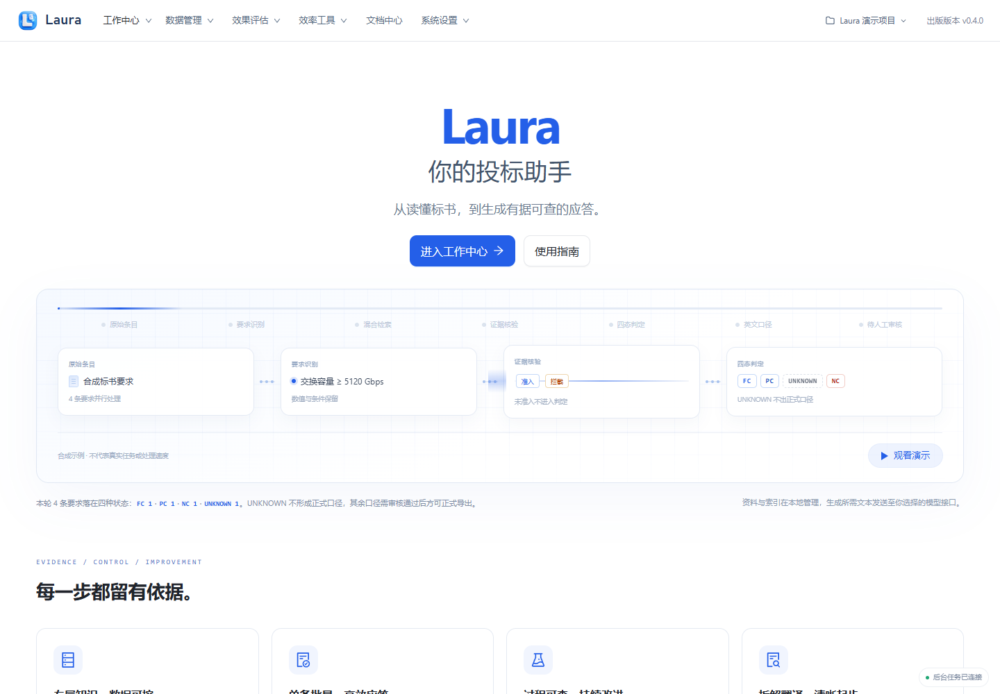

# 入门总览

出版版本：v0.4.2

> 所有截图来自隔离演示实例，使用合成产品、资料、模型结果与四维向量替身；不包含真实业务数据或密钥。真实模型质量、准确率和业务验收仍需另行验证。

[前往工作中心](laura:qa)。此入口只切换页面，不自动创建任务；离线 HTML 请回到 Laura 使用相应导航。

## 推荐阅读顺序

[模型准备](01-模型准备.md) → [项目与产品](02-项目与产品.md) → [构建知识库](03-构建知识库.md) → [首次产品问答](04-首次产品问答.md) → [单条应标](05-单条应标.md) → [Excel应标审核与导出](06-Excel应标审核与导出.md) → [单条翻译](07-单条翻译.md)

首次使用前准备：可用的生成 API 配置与明确联网权限、本机已有向量模型、正确产品资料、待处理条款或普通 `.xlsx`。本指南从首次打开应用开始，不包含源码安装。

构建完成、发布生效、检索命中和能力判定是不同环节；SOC 保留 FC／PC／NC／UNKNOWN，UNKNOWN 不能作正式承诺。

## 1. 首次打开 Laura

从首页上方导航认识工作中心、数据管理、效果评估、文档中心与系统设置；准备产品 Word／PDF、参数 Excel 和待应标 Excel。

**应看到：** 首页展示 Laura 与处理流程；本指南从已可打开的应用开始，不包含源码安装。

## 安装、启动与更新

普通用户下载完整便携 ZIP 并解压后双击 Laura.exe。包内已包含 Python、Node.js、后端依赖和网页，无需手工安装这些运行环境；首次初始化仍需联网准备向量模型。保持目录完整，不单独移动启动器。打开默认浏览器后按指南准备自己的产品、资料和生成接口。

关闭最后一个 Laura 标签页后，刷新缓冲期结束将停止本地服务；普通页面切换与短暂刷新不会新建任务。再次使用时重新双击图标。停止前仍应检查进行中的任务，在途模型请求可能已经计费。

更新可从顶部或系统设置中的“检查更新”页面、包内“检查更新Laura.cmd”进入。首次从旧版升级、任务保护与失败恢复步骤见 [常见问题](08-常见问题.md)。更新不等于重新授权生成 API，本地配置、知识库和历史结果继续保存在既有目录。
