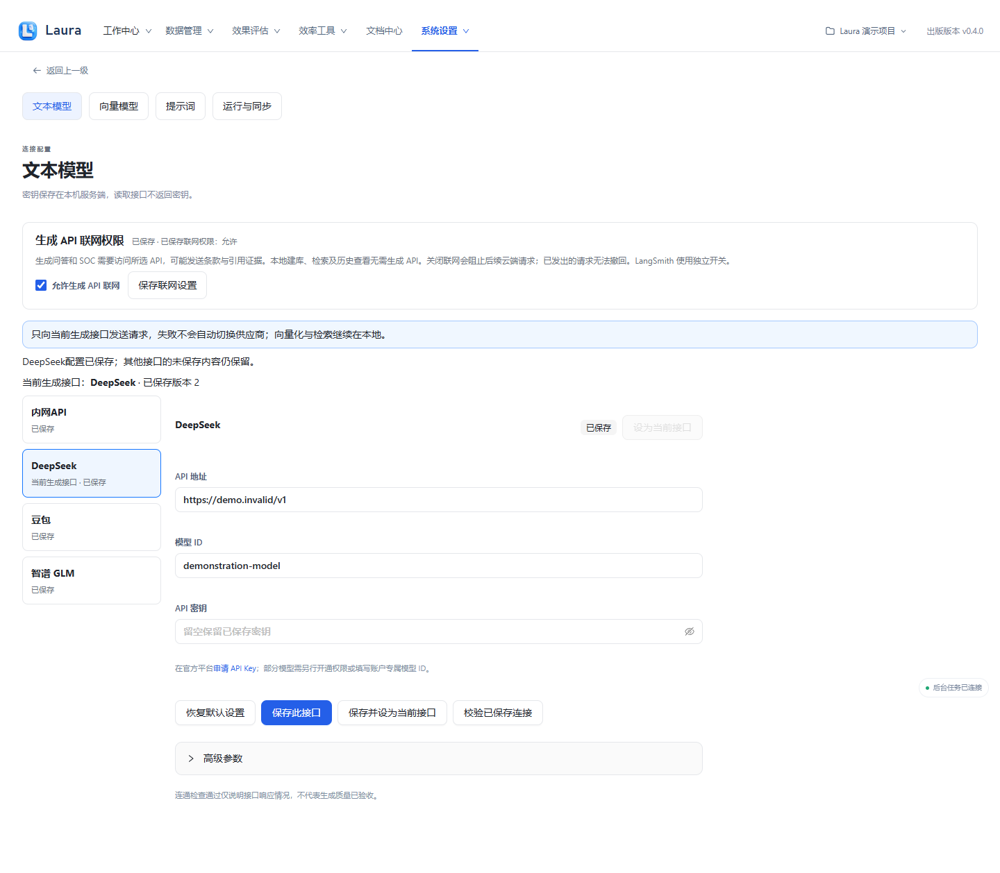
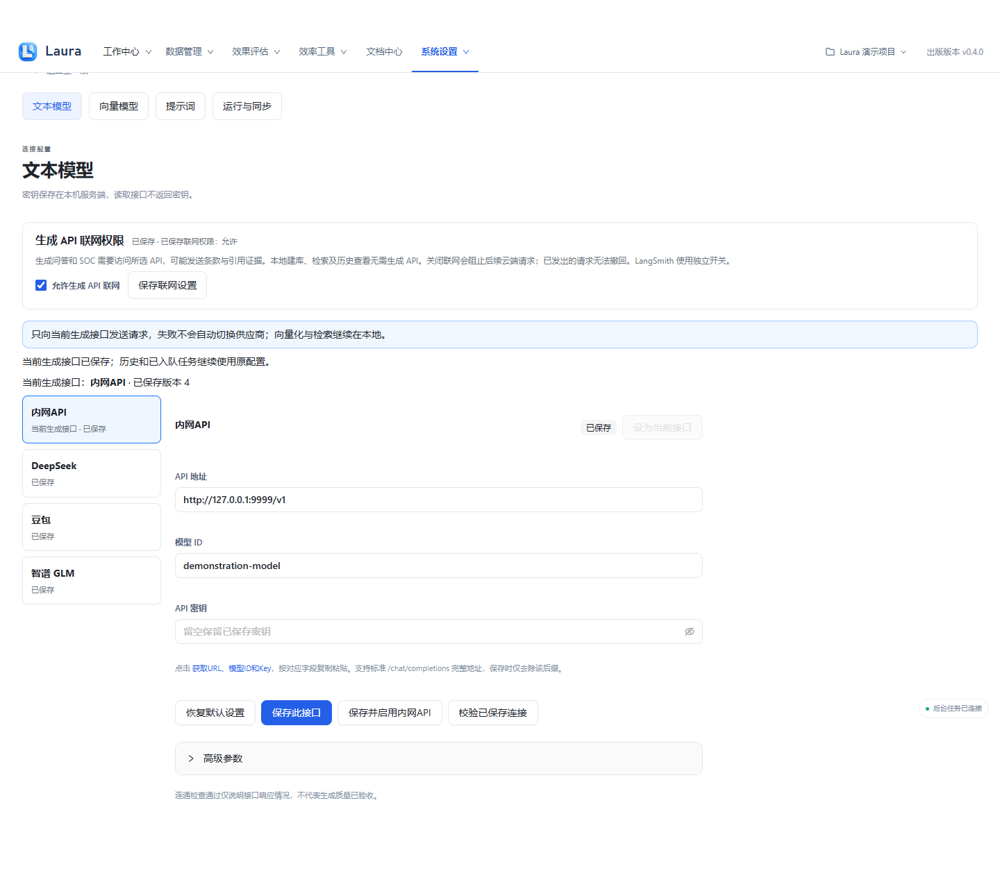
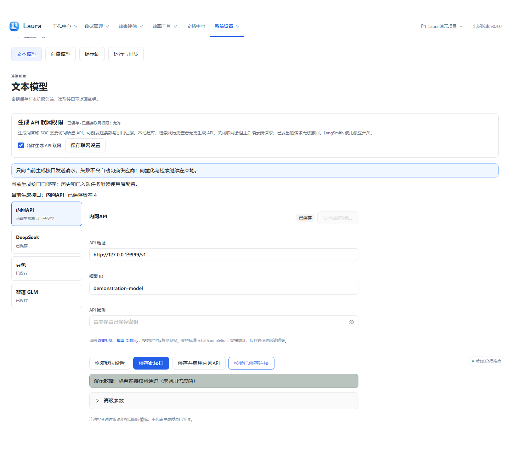
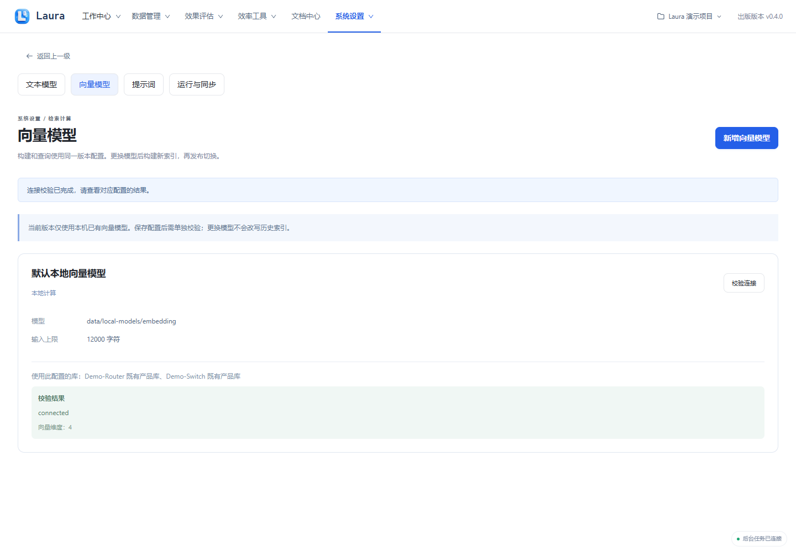
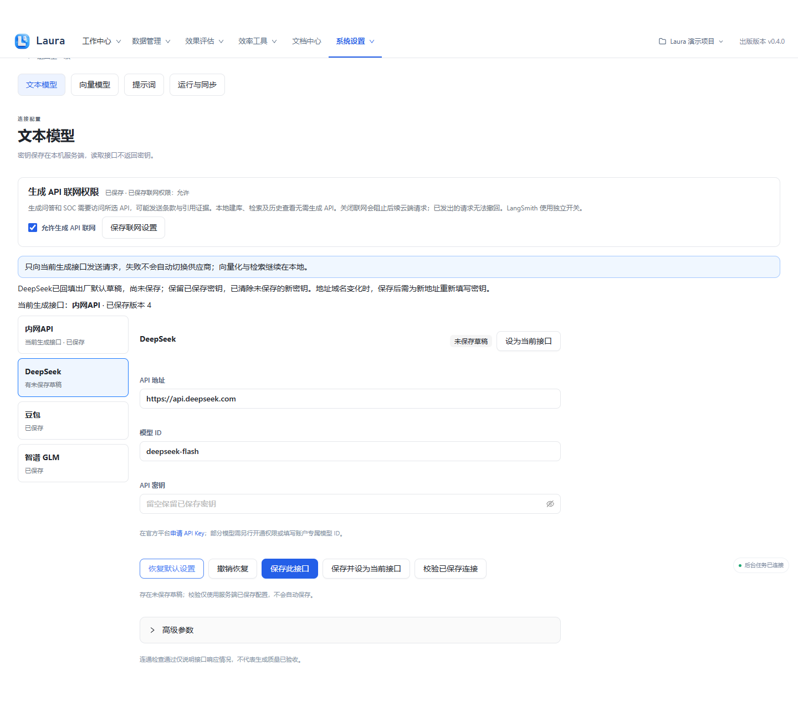

# 模型准备

出版版本：v0.4.6

## 当前版本补充

公共模型预设保留官方地址和模型 ID，Key 输入框下方提供申请入口。内网API 地址、模型 ID 与 Key 由内网API管理员提供。保存后可直接校验指定接口，不必先切换当前接口；业务生成可点击“保存并设为当前接口”。

联网默认关闭。提示“本次校验未发送请求”表示应用权限拦截，不代表 Key 无效。核对地址后可主动“允许生成 API 联网并重新校验”。不支持模型列表时可主动发送固定测试消息，可能计费。

> 所有截图来自隔离演示实例，使用合成产品、资料、模型结果与四维向量替身；不包含真实业务数据或密钥。真实模型质量、准确率和业务验收仍需另行验证。

[前往文本模型](laura:models)。此入口只切换页面，不自动创建任务；离线 HTML 请回到 Laura 使用相应导航。

## 1. 保存文本模型接口

打开系统设置 → 文本模型，选 DeepSeek，填供应商 API 地址、模型 ID 和你本机的密钥，再点“保存此接口”。截图为无真实密钥的隔离接口。

**应看到：** 显示该接口配置已保存；密钥不会回显。保存不等于连接通过。

## 2. 设为当前接口与启用内网API

内网API的地址与模型 ID 出厂为空，不从作者配置复制。先通过 [申请内网API Key](https://maas-openclaw.zte.com.cn/zte-paas-coclaw-ui/#/getkey) 获得有权使用的账号与服务信息，核对 Base URL、模型 ID 和密钥后点击“保存并启用内网API”。首次使用须阅读发送说明并明确授权；必要条款与证据将发送到所选端点，保存或恢复草稿不代表联网授权。其他公共接口仍可单独保存并设为当前接口。

选中要使用的接口后点“设为当前接口”；不同接口的编辑草稿分别保留。

**应看到：** 页面“当前生成接口”更新；新任务只向当前接口发送请求，失败不会自动切换供应商。

## 3. 校验已保存连接

点“校验已保存连接”，检查服务端已保存配置的返回结果；有未保存草稿时先保存。

**应看到：** 本图为演示校验；实际使用需按返回信息核对地址、模型及鉴权。连通通过不代表应答质量验收。

## 4. 确认生成联网权限

在“生成 API 联网权限”确认开关。实际使用云端生成前由你明确允许联网；关闭时不发送生成请求。

**应看到：** 开关展示当前权限。演示实例虽开启权限，仍由替身处理，任何遗漏的 HTTP 请求会失败。

## 5. 确认本地向量模型

打开系统设置 → 向量模型，核对本机路径，点“校验连接”。没有配置时点“新增向量模型”，填写已准备好的模型路径。

**应看到：** 显示本地配置和校验结果。截图的四维向量是演示替身；真实构建和查询必须使用一致的本地模型版本。

## 6. 恢复当前接口的默认草稿

选中接口后点“恢复默认设置”，将此接口的地址、模型 ID 和高级参数回填为应用发行默认值；已有未保存内容时先确认替换。其他接口草稿、当前生成接口和联网权限不变。内网API 的出厂地址和模型 ID 为空，需按公司实际服务填写。

恢复后仍是未保存草稿，可“撤销恢复”或继续编辑，点“保存此接口”后生效。恢复会清除尚未保存的新密钥；保留的是服务端已保存密钥，不回显。若地址域名改变，旧密钥不会自动发送到新域名，需为新地址重新填写。连接校验结果会清除，须对保存后的配置重新检查。

**应看到：** 当前接口表单回填默认配置，并提示尚未保存；可撤销恢复。点击“保存此接口”前，已保存的配置与密钥保持不变。

