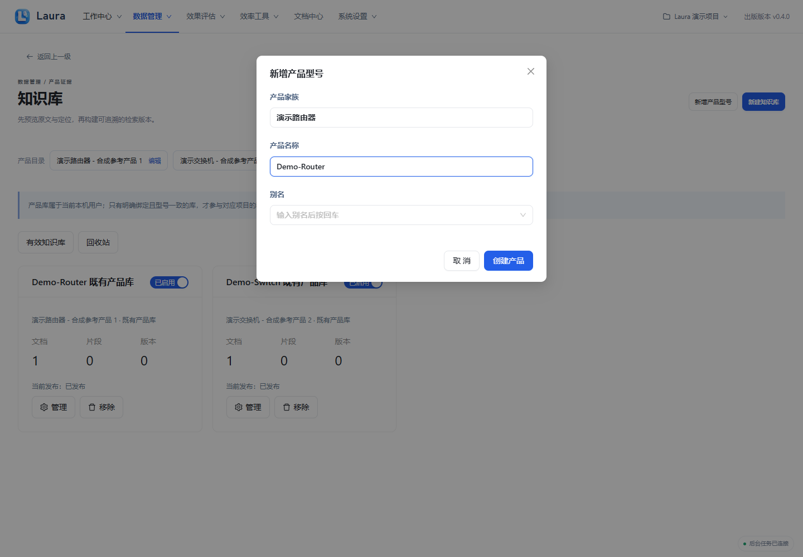
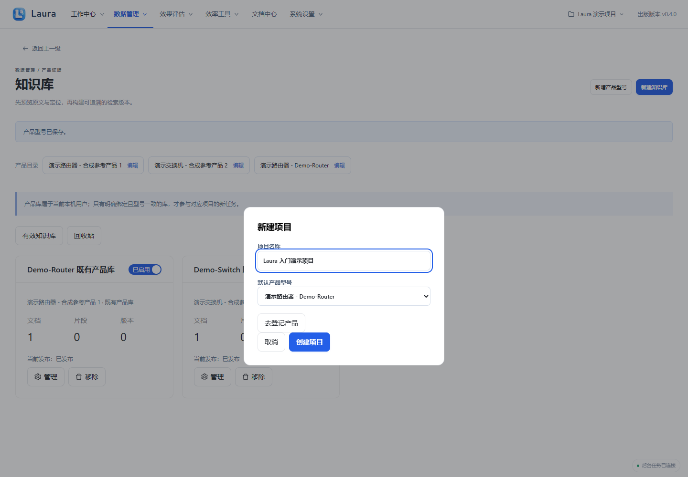
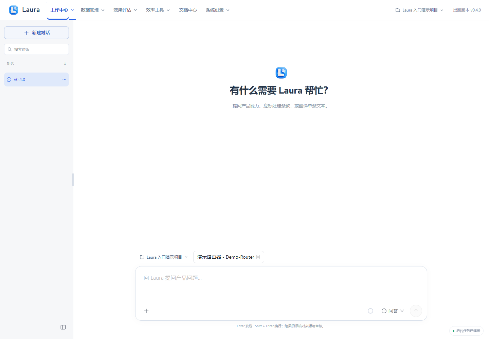

# 项目与产品

出版版本：v0.4.6

## 当前版本补充

没有产品时，新建项目弹窗提供“去登记产品”；登记完成返回弹窗，保留项目名并自动选中新产品。项目管理提供“移入回收站”和“项目回收站 → 恢复项目”。回收保留会话、结果、文件及知识库绑定，不删除共享产品和知识库；排队/运行任务存在时需先处理。回收项目不能继续新增或恢复任务。本版不提供永久删除项目。

> 所有截图来自隔离演示实例，使用合成产品、资料、模型结果与四维向量替身；不包含真实业务数据或密钥。真实模型质量、准确率和业务验收仍需另行验证。

[前往项目管理](laura:projects)。此入口只切换页面，不自动创建任务；离线 HTML 请回到 Laura 使用相应导航。

## 1. 创建产品家族与名称

在数据管理 → 知识库点“新增产品型号”，填写产品家族“演示路由器”和产品名称“Demo-Router”，点“创建产品”。

**应看到：** 名称必填；创建后产品进入产品目录，供项目及知识库选择。

## 2. 新建项目并选产品

打开顶部“当前项目”，选择新建项目，填“Laura 入门演示项目”，默认产品选择“Demo-Router”，点“创建项目”。

**应看到：** 项目创建后进入工作中心；后续知识库必须与本次任务所选产品一致。

## 3. 建立会话

在工作中心左侧点“新建对话”，核对输入框上方的项目与“本次任务型号”。

**应看到：** 左侧出现当前会话；问答、应标与翻译可以在会话中切换，草稿随会话保存。

