# 构建知识库

出版版本：v0.4.6

> 所有截图来自隔离演示实例，使用合成产品、资料、模型结果与四维向量替身；不包含真实业务数据或密钥。真实模型质量、准确率和业务验收仍需另行验证。

[前往知识库](laura:knowledge)。此入口只切换页面，不自动创建任务；离线 HTML 请回到 Laura 使用相应导航。

## 1. 填写知识库基础信息

点“新建知识库”，填写名称、说明，产品型号选 Demo-Router，再点“下一步”。

**应看到：** 资料按产品隔离；只选中正确产品的资料才能用于相应任务。

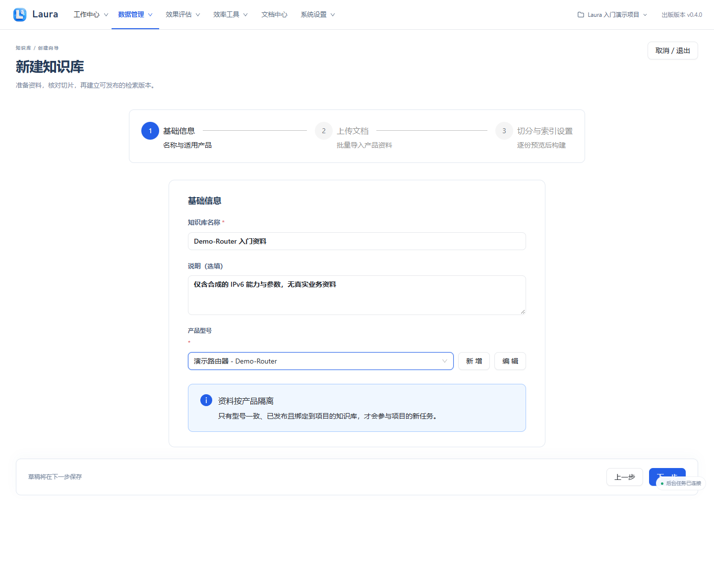

## 2. 选择来源类型并上传资料

选择来源类型“功能清单”，选择 Word、可提取文字的 PDF 与 Excel，点“上传全部文件”，逐项核对文件名、格式和状态。

不属于产品说明、功能清单、标准清单或规划资料时，可选择“其他”。来源类型只说明资料类别，不代表已经证实产品能力；规划资料仍受规划证据限制。

**应看到：** 三份文档均显示上传成功。规划资料不能证明当前能力；扫描 PDF 要先完成文字识别。

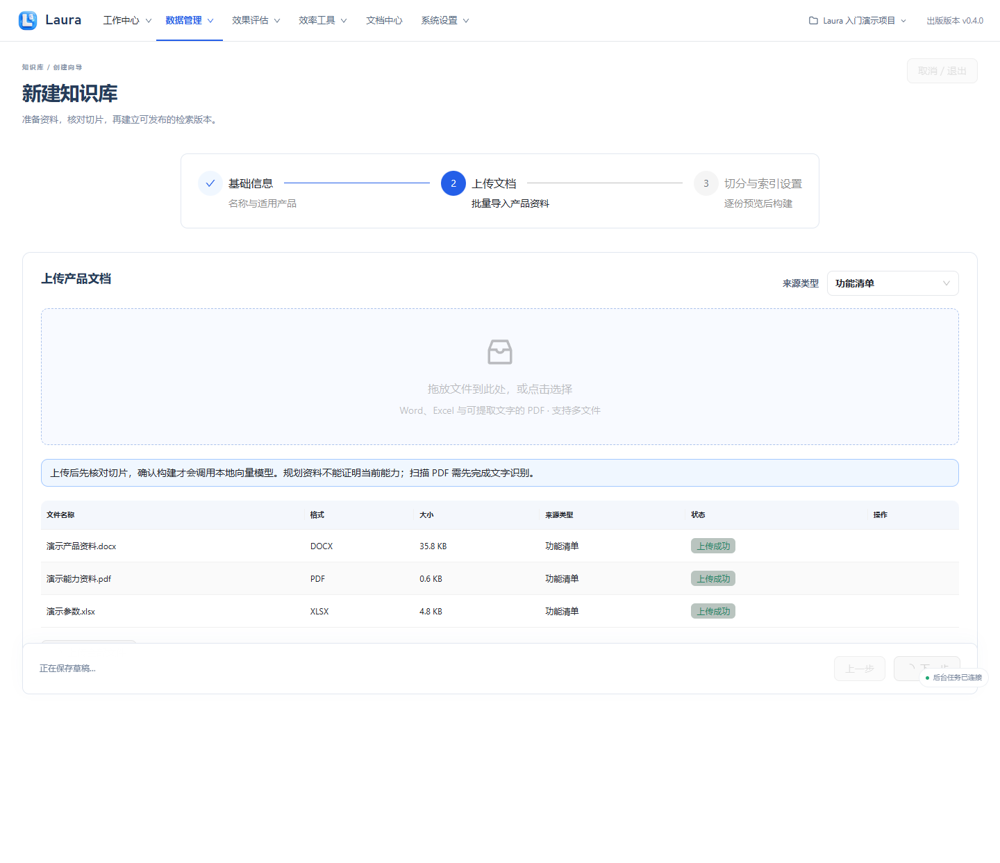

## 3. 配置 Word 切分

在左侧逐份选择 Word，切分策略采用“完整叶标题小节”，保持产品条件、否定、单位与标题完整；此策略按完整标题小节切分，逻辑上限由本地向量档案检查。没有标题的文档改用“段落合并”，再设置切片长度与重叠。

若希望整篇作为一个检索片段，可选择“保留原始文档”，再点“预览切片”。此时不显示长度或重叠设置；原件照常保留，预览展示提取文本而非原件版式。整篇超过所选向量档案上限时会显示实际字符数与上限，需要改选策略或档案，不会截断或自动拆分。

**应看到：** 当前文档的独立规则显示在右侧；切换文档不会把规则自动套给其他文档。

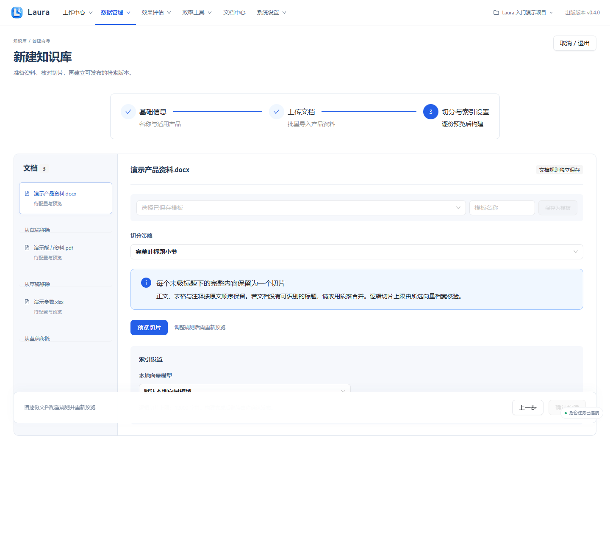

## 4. 检查 Word 切片

点“预览切片”，展开片段，核对原文、标题／段落位置与适用条件。

**应看到：** 可看到 IP当前版本 原文与定位；预览尚未向量化。修改规则后必须重新预览。

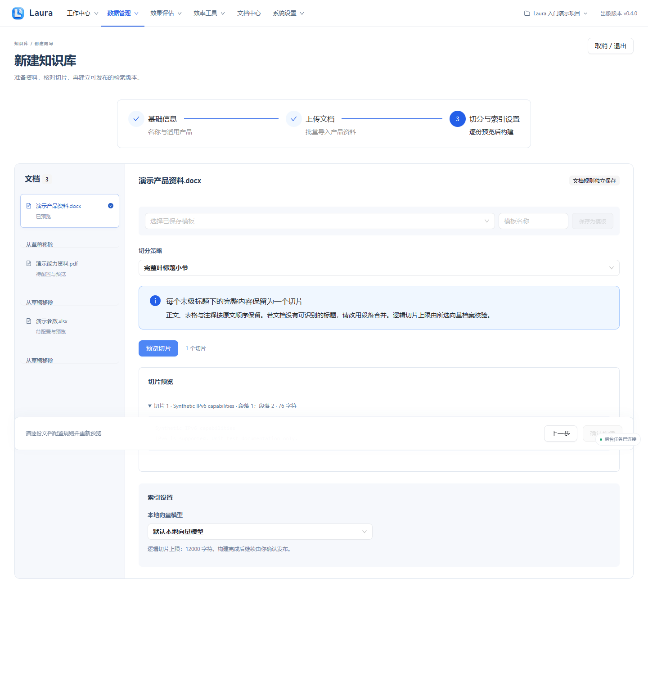

## 5. 配置 PDF 切分

左侧选择 PDF，选择“段落合并”，核对字符上限。PDF 先确认文字能提取，扫描件应先 OCR 后重新上传。

文字 PDF 也可选择“保留原始文档”，按页序合为一个片段，并显示全文页码范围。Excel 不支持整篇策略，继续选择工作表、行列范围并按记录处理。

**应看到：** 规则针对 PDF 单独设置；下一步预览须同时核对页码与文字顺序。

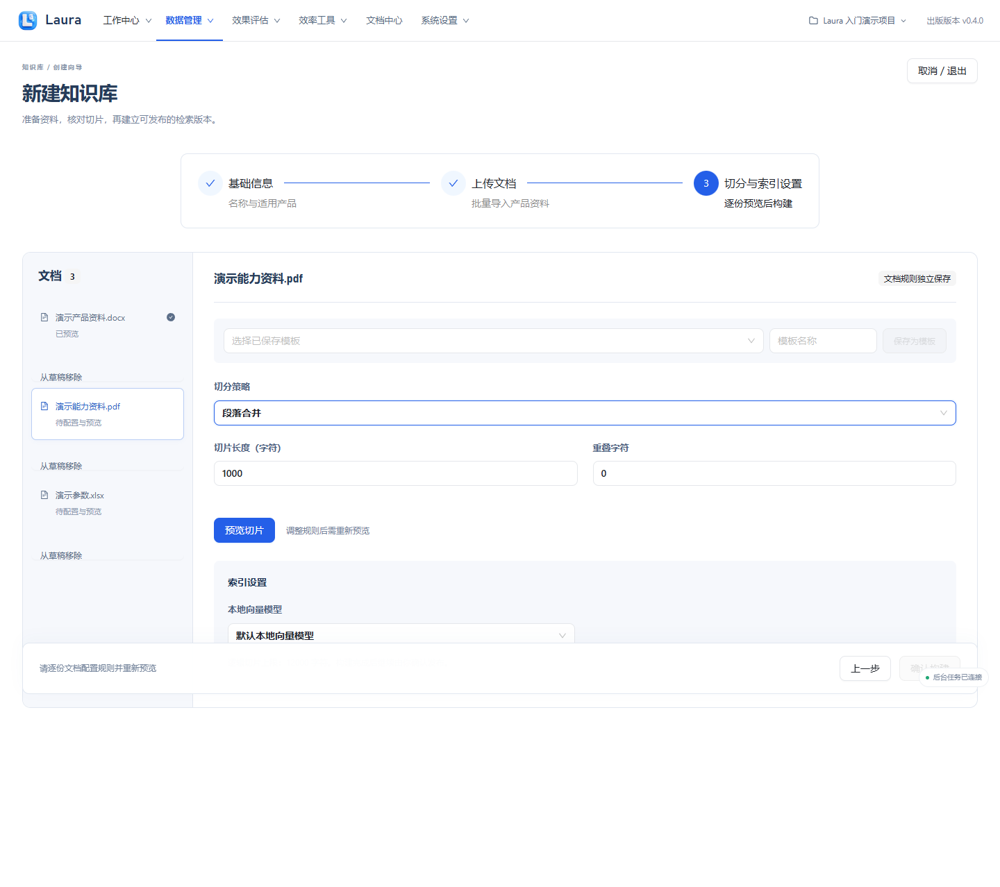

## 6. 检查 PDF 页码与正文

点“预览切片”，核对合成产品说明中的 IP当前版本 支持与 IPv4 不支持，并检查页码定位。

**应看到：** 片段含可读文字与 PDF 位置；检索命中此片段仍不等于条款已经获得能力判定。

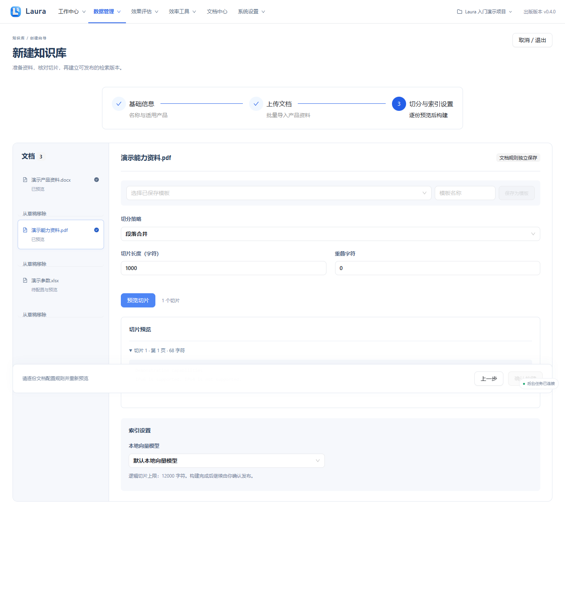

## 7. 配置 Excel 工作表与列范围

选择 Excel，核对工作表“产品参数”、表头行 1、内容列 Capability、参数列 Value／Unit、起止行 2 到 3；界面会展示候选列与样例数据，请按实际表格调整。

**应看到：** Excel 以记录保留参数和值；不要把旧应答或备注列选作能力证据。工作表、表头、列和行范围必须明确。

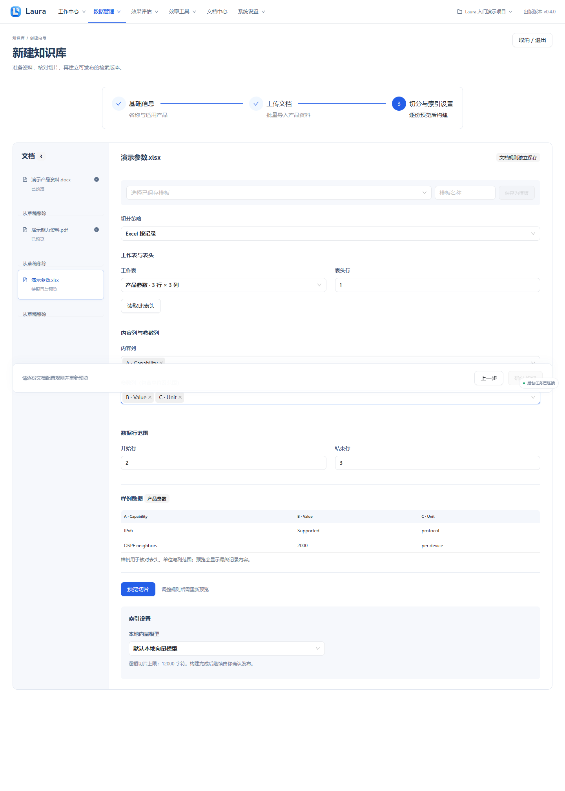

## 8. 检查 Excel 参数片段

点“预览切片”，展开参数片段，核对工作表、行号、参数值和单位。

**应看到：** 每条有效记录可追溯到 Excel 行；值与单位没有被丢弃，所有启用文档均须完成有效预览。

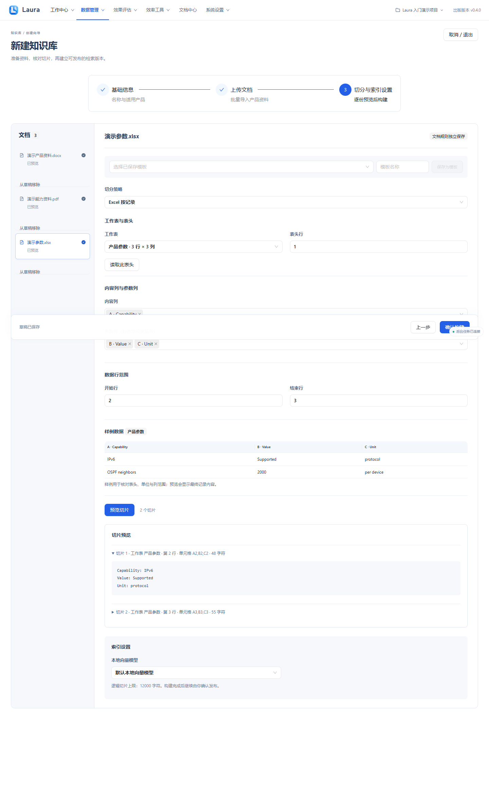

## 9. 选择本地向量模型并确认构建

在索引设置选择已校验的本地向量模型，核对切片上限；所有文档都预览后点“确认构建”。本次先演示退出和恢复，再提交构建。

**应看到：** “确认构建”可点击；真正向量化只在提交构建后发生。构建结束仍须手动发布。

## 10. 保存草稿并退出

点右上“取消／退出”，在弹窗选择“保存草稿并退出”；继续编辑会留在当前页，放弃本次草稿会回收新库草稿。

**应看到：** 弹窗明确说明：放弃更新草稿保留已发布版本；退出不等于取消后台构建。

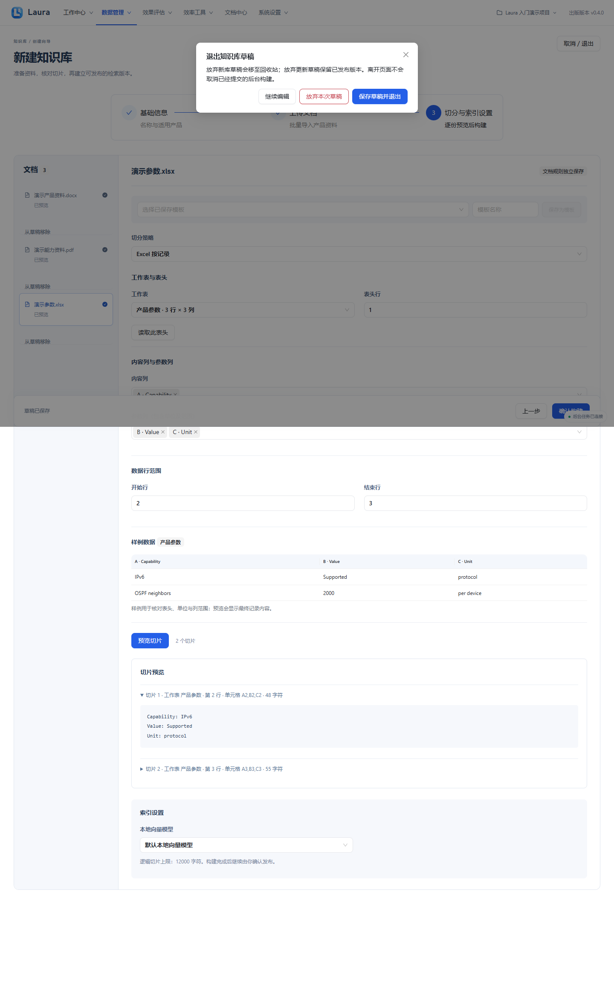

## 11. 继续创建草稿

从知识库列表打开 Demo-Router 入门资料，在“设置”点“继续创建”。已保存的逐份规则与有效预览恢复。

**应看到：** 回到切分与索引设置；仍需核对规则与本地模型后点“确认构建”。

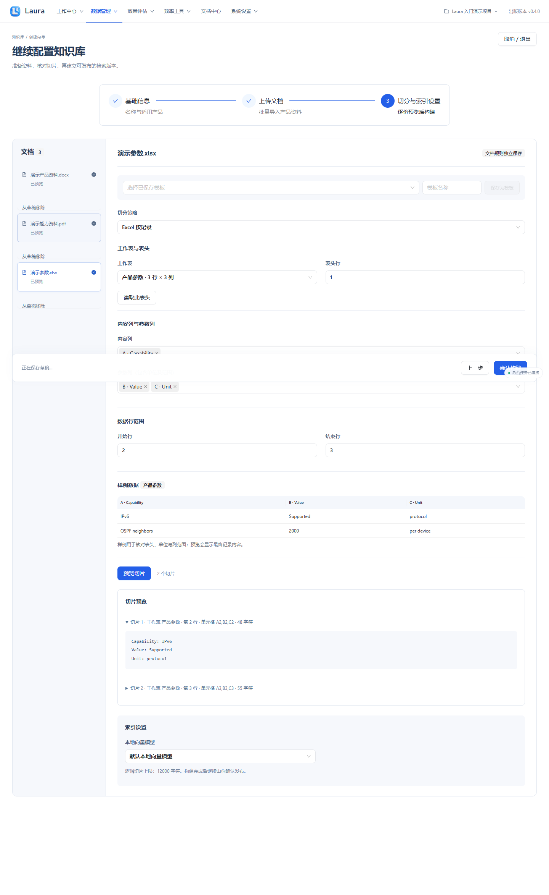

## 12. 查看构建结果并发布

在“构建记录”检查状态与文档／片段数量，确认无错误后点“发布此版本”。

**应看到：** 构建完成只是新版本就绪，发布才让它成为本库的新检索版本；旧任务继续引用原快照。

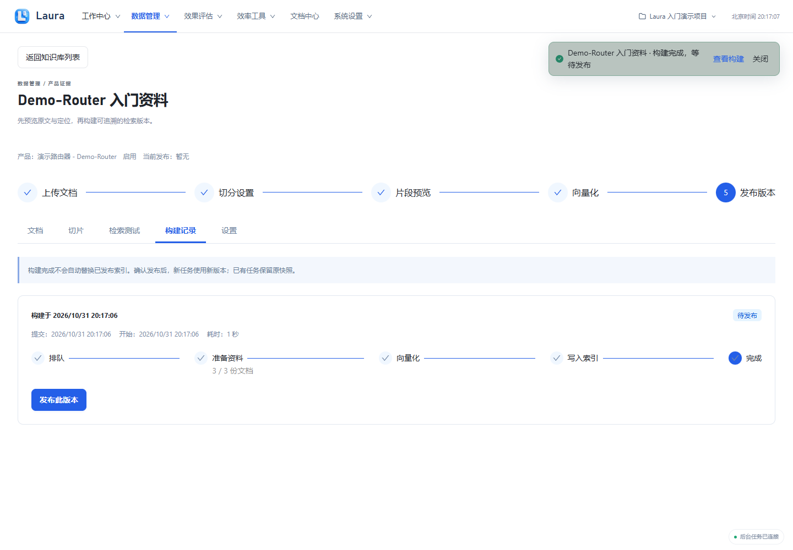

## 13. 绑定项目并确认启用

在“设置”→ 项目绑定选择“Laura 入门演示项目”，点“保存项目绑定”；确认“启用知识库”开关已启用。

**应看到：** 显示项目绑定已保存。实际新任务还需所选产品与库的产品一致，且使用已发布版本。

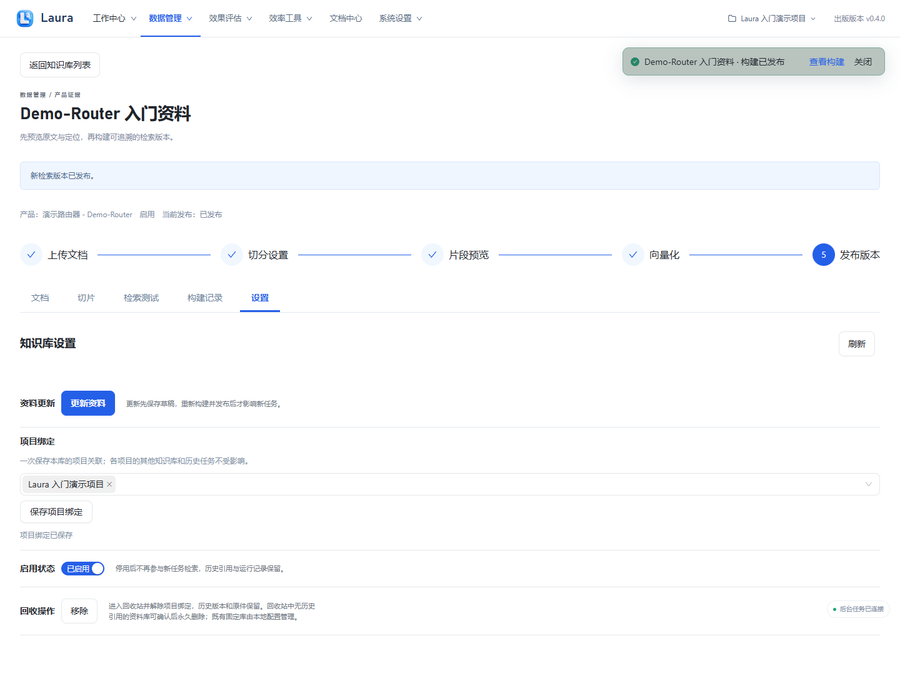

## 14. 检索本库检查候选资料

在“检索测试”选择当前发布版本，输入 IP当前版本，点“检索本库”，核对来源名、原文与定位。

**应看到：** 出现候选片段；本页只验证本库检索。构建完成、发布生效、检索命中与能力判定是四个不同环节。

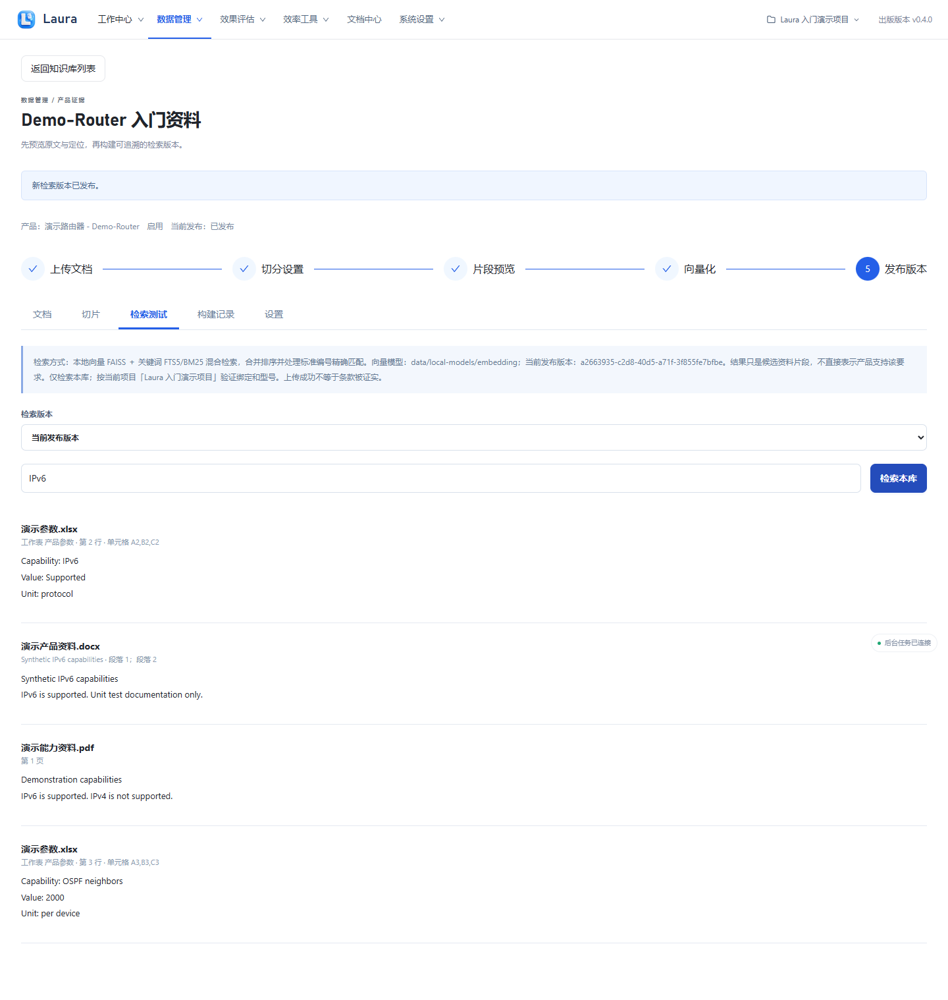

## 15. 更新资料进入独立草稿

在已发布库“设置”点“更新资料”（已有草稿时显示“继续编辑草稿”），在向导中更新上传资料或逐份规则，再重新预览并确认构建。

**应看到：** 编辑的是草稿，当前已发布版本继续生效；草稿改动不会立即改变新任务检索。

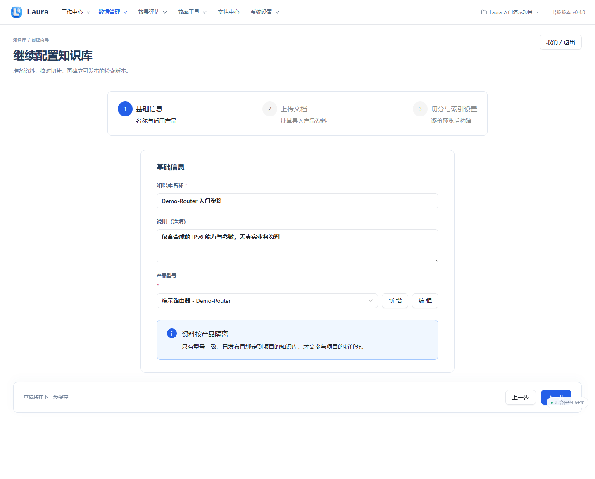

## 16. 重新构建后再次发布

更新资料完成后重新构建，在构建记录核对新版本，再点“发布此版本”。本演示使用相同合成资料再构建。

**应看到：** 新版本发布前旧版仍生效；再次发布后仅后续任务切换，历史引用保持原快照。

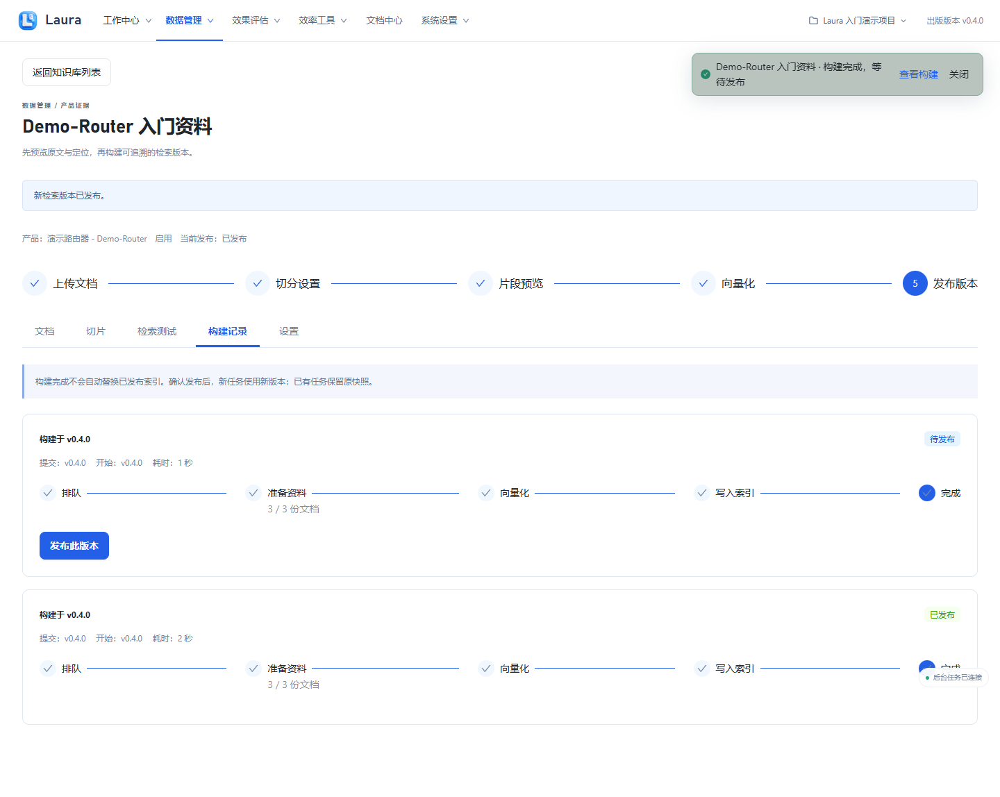

## 17. 回收与永久删除

移除知识库会放入回收站并解除项目绑定，历史来源仍可查看。可在回收站恢复，恢复后需重新确认绑定。

不再需要的自建资料库可在回收站点“永久删除”，输入完整库名称并再次确认。存在历史任务、问答、评测或引用时会阻止删除并说明原因；请保留该库以便追溯原始来源。无历史引用时才删除原件、切片和索引版本，无法恢复。既有固定产品库由本地配置管理，保留回收状态，不能通过此入口删除原始配置来源。

后台构建尚未确认停止时不能删除。若提示文件清理尚未完成，请在同一确认框重试；尚未出现删除完成提示时，不应视为清理完成。

文件清理失败时，回收站会保留“待完成文件清理”条目，关闭弹窗或重启后仍能找到。此条目仅可“重试文件清理”，不能恢复、管理或用于新检索；清理完成后消失。

**应看到：** 永久删除前要求输入完整库名称；有历史引用时显示阻止原因，无引用且确认删除成功后条目消失。清理失败时显示可重试的“待完成文件清理”条目。

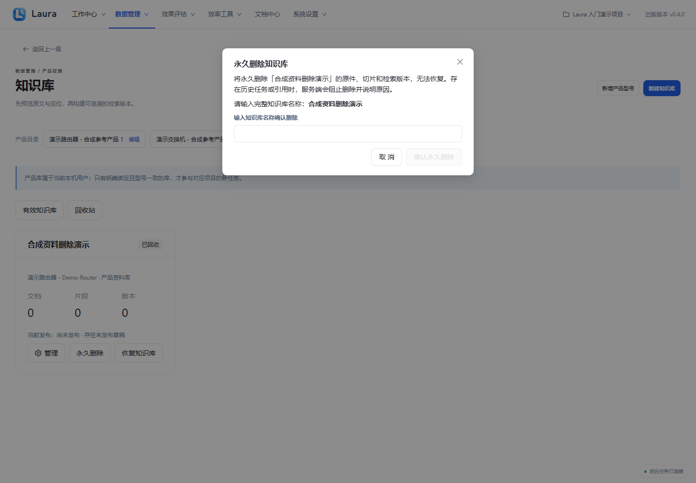
