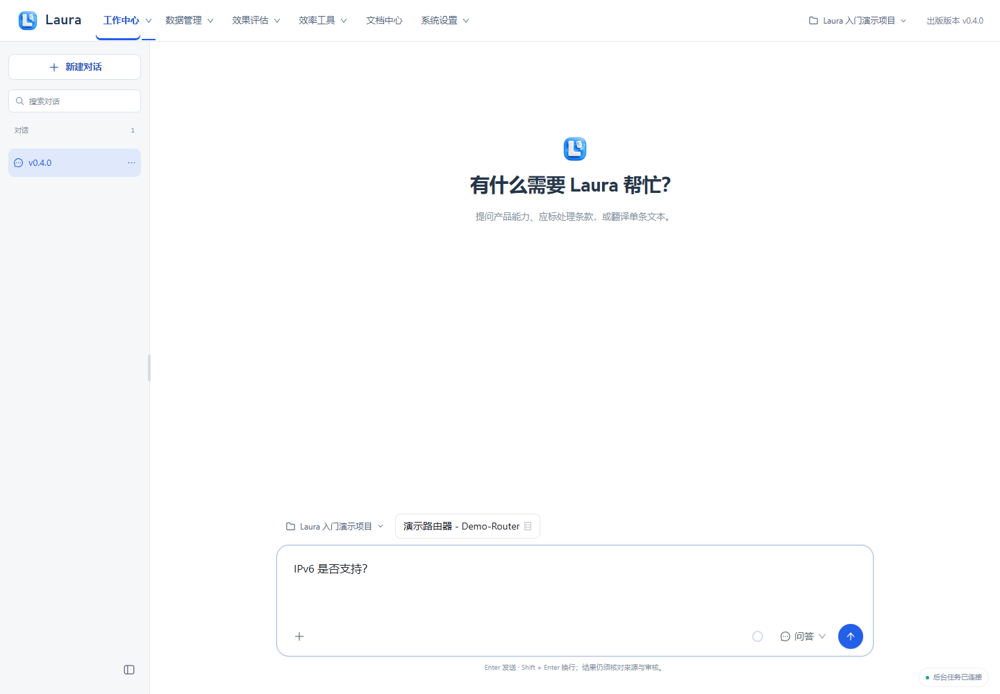
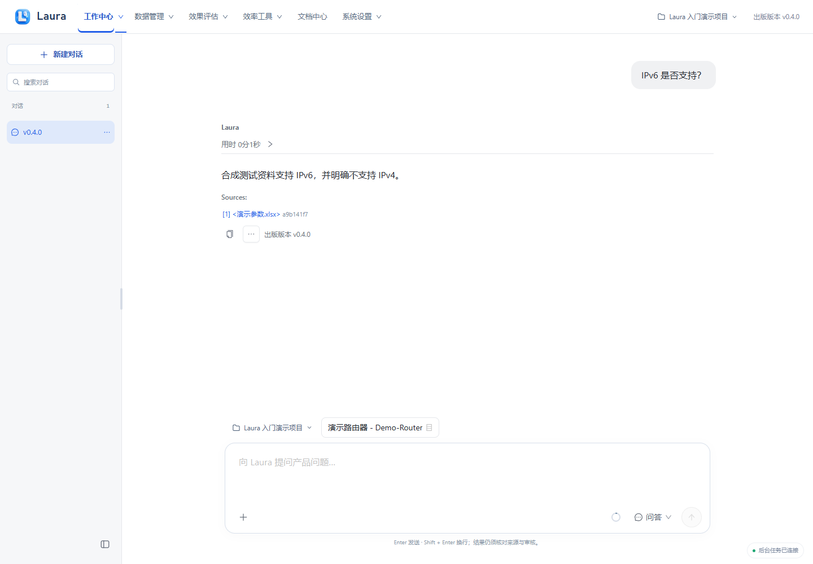
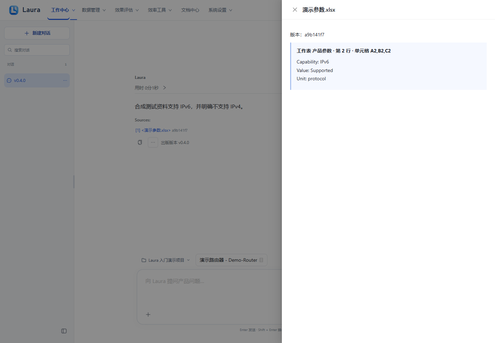
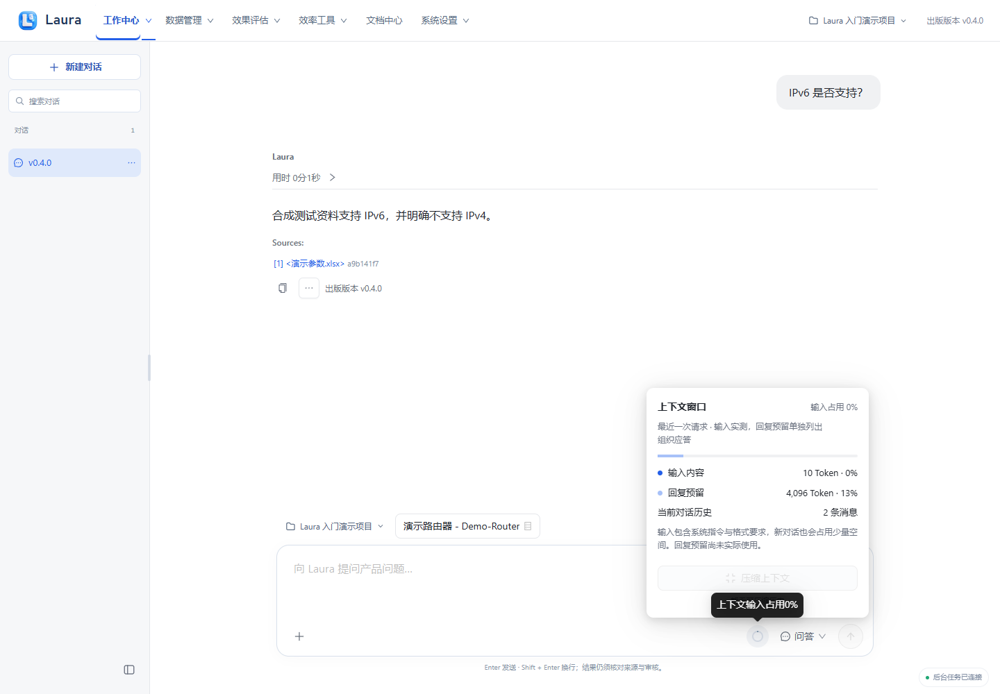

# 首次产品问答

出版版本：v0.4.1

> 所有截图来自隔离演示实例，使用合成产品、资料、模型结果与四维向量替身；不包含真实业务数据或密钥。真实模型质量、准确率和业务验收仍需另行验证。

[前往工作中心](laura:qa)。此入口只切换页面，不自动创建任务；离线 HTML 请回到 Laura 使用相应导航。

## 1. 选择项目型号并提问

在工作中心核对当前项目及本次任务型号 Demo-Router，切换“问答”，输入“IP当前版本 是否支持？”后点发送。

**应看到：** 发送前可看到问答模式、输入文本与任务型号；问答使用匹配且已发布绑定的资料。

## 2. 阅读回答和来源

阅读 Laura 回答，点击 Sources 下的资料名称，逐条核对原文与适用条件。

**应看到：** 回答下面有来源入口；答案文本为演示数据，不能作为真实产品承诺。

## 3. 核对来源位置

在来源侧栏核对版本、原文和位置；对缺失或不适用来源的回答继续补证。

**应看到：** 来源侧栏显示原文及定位；引用存在不等于引用一定足以支持所有条件。

## 4. 查看上下文预算

点输入区“上下文”查看本次任务的上下文情况；内容过长时新建会话或精简输入。

**应看到：** 弹出上下文用量与组成说明；上下文情况与资料检索命中不是同一指标。

