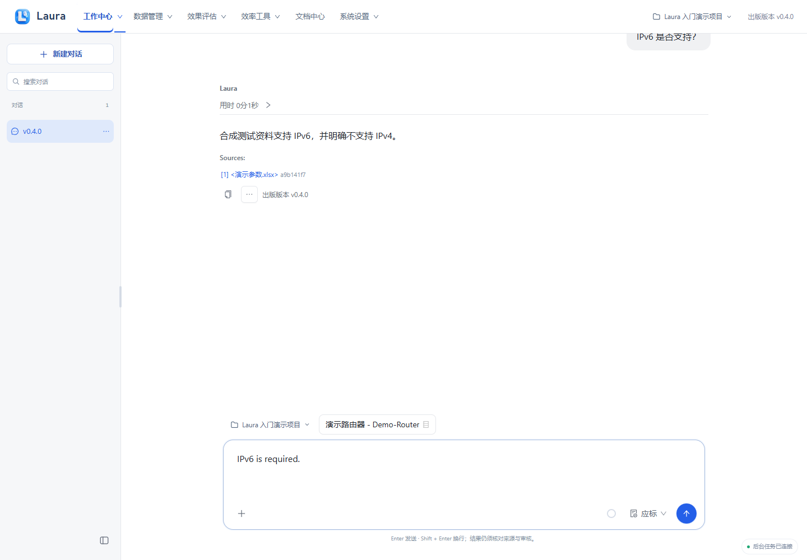
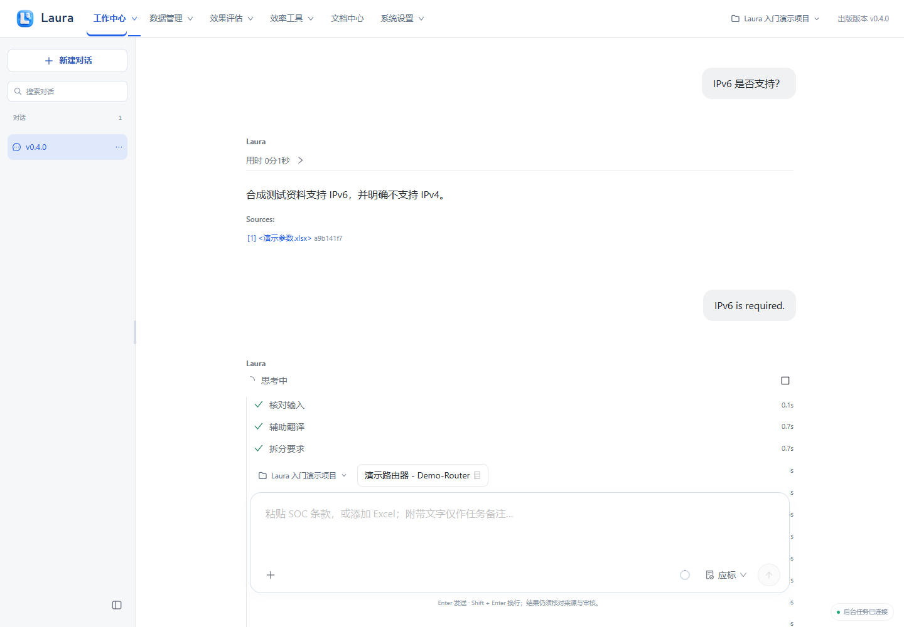
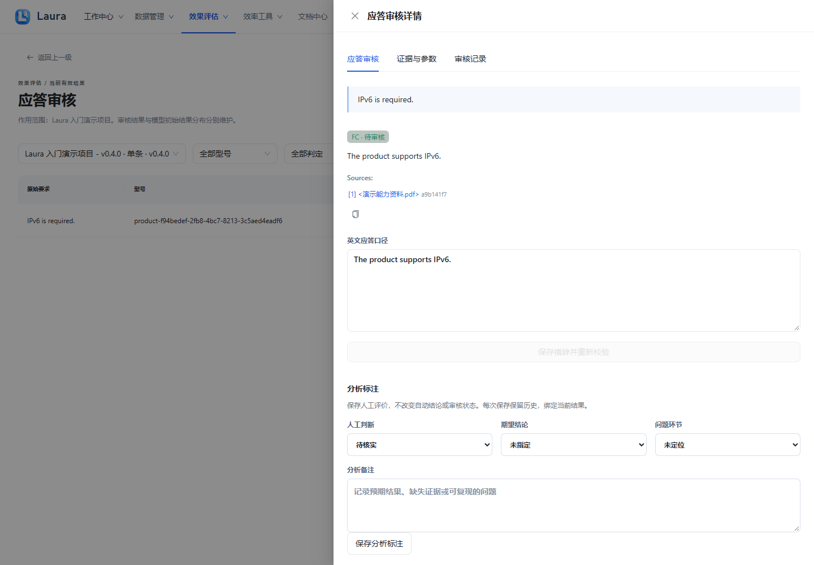

# 单条应标

出版版本：v0.4.1

> 所有截图来自隔离演示实例，使用合成产品、资料、模型结果与四维向量替身；不包含真实业务数据或密钥。真实模型质量、准确率和业务验收仍需另行验证。

[前往工作中心](laura:soc)。此入口只切换页面，不自动创建任务；离线 HTML 请回到 Laura 使用相应导航。

## 1. 提交单条技术要求

切换“应标”，粘贴完整原文“IP当前版本 is required.”，保留否定、数值和条件，点发送。

**应看到：** 输入框处于应标模式；这次只处理一条要求，结果仍需人工审核。

## 2. 理解判定并核对证据

阅读 FC／PC／NC／UNKNOWN 与 Sources；FC 为充分满足、PC 为部分满足、NC 为已证实不满足、UNKNOWN 为证据不足或未决。点击状态标签进入审核。

**应看到：** 本合成要求显示 FC · 待审核；UNKNOWN 不得生成正式承诺，不能把无资料当成已证实 NC。

## 3. 进入应答审核

点击“FC · 待审核”打开详情，核对要求、结论、英文口径与来源后按实际情况审核。

**应看到：** 出现应答审核详情；单条结果无需 Excel 映射，正式批量回填另走 Excel 门禁。

