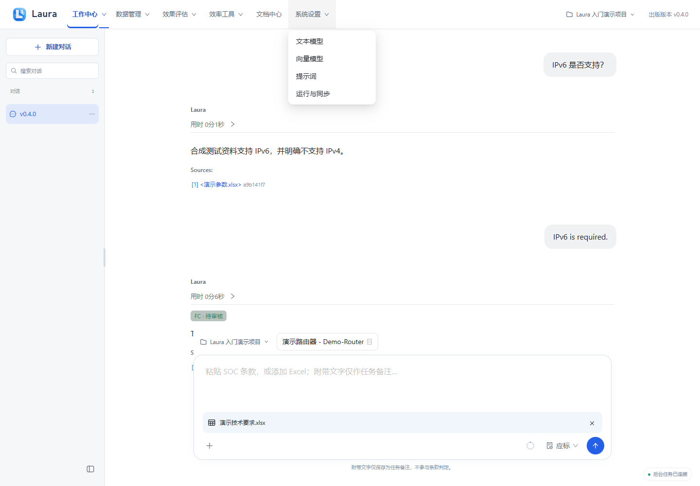
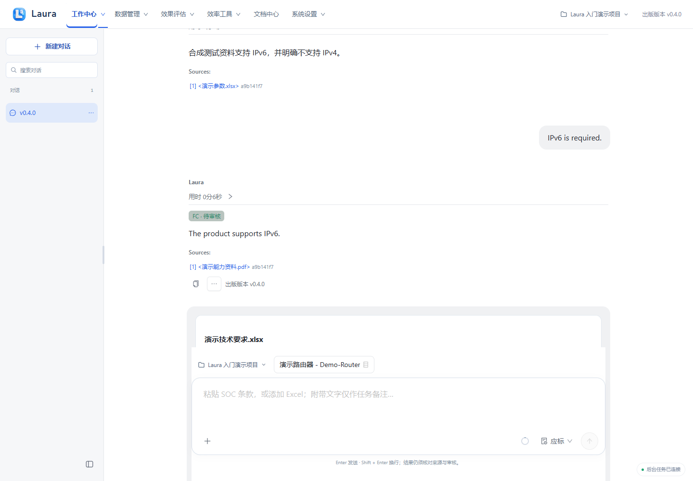
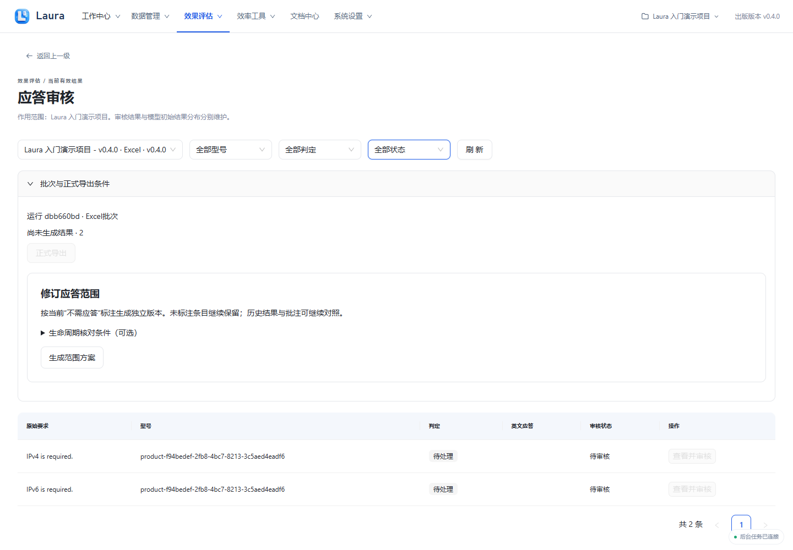
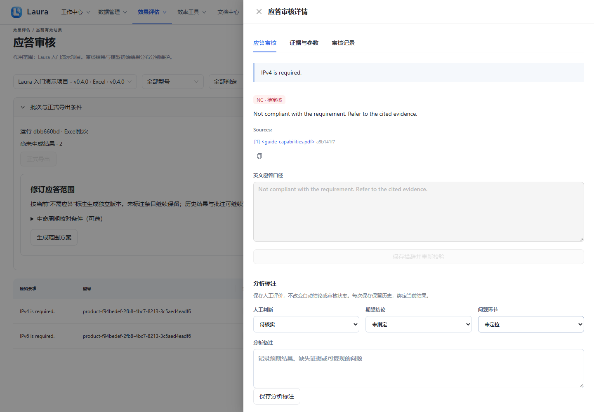
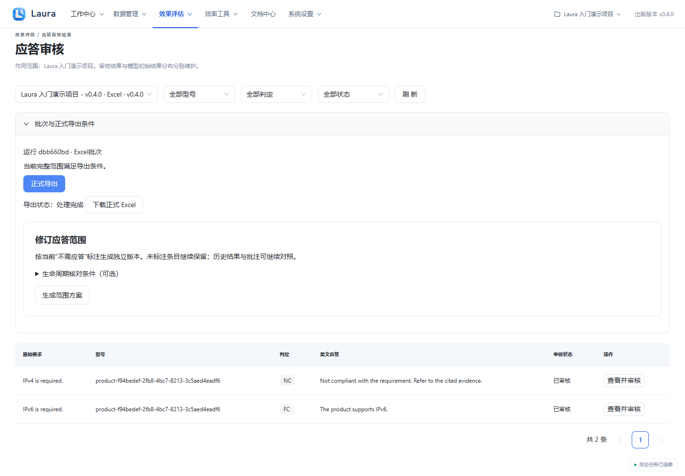

# Excel应标审核与导出

出版版本：v0.4.1

> 所有截图来自隔离演示实例，使用合成产品、资料、模型结果与四维向量替身；不包含真实业务数据或密钥。真实模型质量、准确率和业务验收仍需另行验证。

[前往应答审核](laura:review)。此入口只切换页面，不自动创建任务；离线 HTML 请回到 Laura 使用相应导航。

## 1. 上传待应标 Excel

在应标模式点输入框加号，选择普通 .xlsx，核对附件文件名后发送；随附文字只保存为任务备注。

**应看到：** 文件作为附件保留，发送后先识别，不会立即生成应标结果。

## 2. 核对识别摘要与映射

核对自动识别的工作表、表头、技术输入列和输出位置；本例选“技术要求”，技术原文在 A 列。需要时展开“调整识别”修正工作表与列，展开“调整范围”修正行。

**应看到：** 只有识别与映射有效，“开始应标”才可点击；不会把旧应答列当作要求原文。

## 3. 确认后开始处理

确认映射后点“开始应标”，等待批量结果；完成后点“前往应答审核”。

**应看到：** 卡片显示批量任务进度与审核入口；中断时保留任务记录，核对输入、Worker 和模型后从原任务处理。

## 4. 查看正式导出条件

在应答审核查看待审核条目与导出原因。正式导出要求当前结果、有效证据、合法映射以及全部应审核条目通过。

**应看到：** 未审核时“正式导出”不可用；UNKNOWN、失效证据或无效口径不能靠点击审核绕过门禁。

## 5. 逐条核对并审核

点“查看并审核”，对照原要求、FC／NC 结论、口径与引用，确认正确才点“确认审核通过”。有问题先补资料或修正，不批量盲审。

**应看到：** 审核详情能看到证据与批准按钮；通过后出现撤销批准入口。

## 6. 生成并下载正式结果

所有条目核对通过后点“正式导出”，再点“下载正式 Excel”，保存并打开检查回填列及原表内容。

**应看到：** 出现正式下载入口；导出成功仅验证程序与审核闭环，本演示不证明真实模型业务质量。

