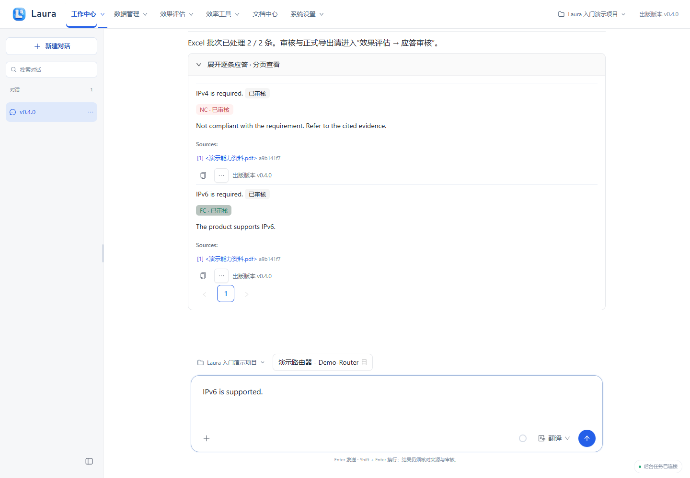
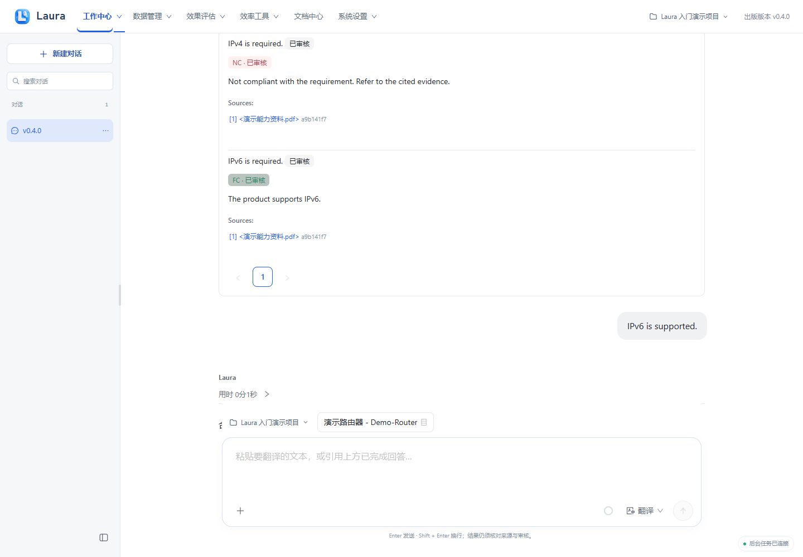
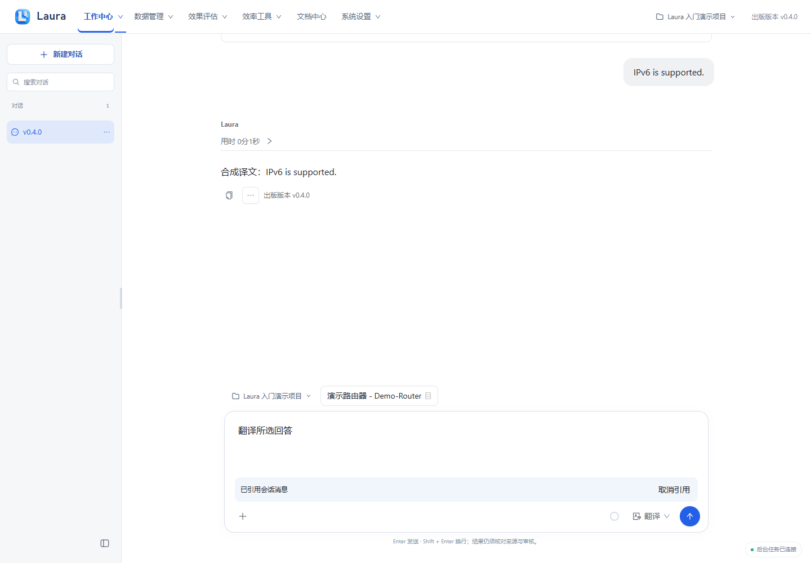

# 单条翻译

出版版本：v0.4.1

> 所有截图来自隔离演示实例，使用合成产品、资料、模型结果与四维向量替身；不包含真实业务数据或密钥。真实模型质量、准确率和业务验收仍需另行验证。

[前往工作中心](laura:translation)。此入口只切换页面，不自动创建任务；离线 HTML 请回到 Laura 使用相应导航。

## 1. 选择翻译方向并输入文本

在工作中心切换“翻译”，在同一菜单选择“英译中”或“中译英”，粘贴单条文本后发送。

**应看到：** 翻译模式与方向显示在输入区；翻译不套用 SOC 四态或正式回填审核。

## 2. 查看并复制译文

核对术语、否定与数值，点译文旁“复制回答”复制文本。

**应看到：** 译文在会话中显示，不出现 FC／PC／NC／UNKNOWN；合成译文不作为真实翻译质量验收。

## 3. 引用已有回复继续翻译

在已完成回复旁打开“更多回答操作”，选择“引用并翻译”，检查引用标记、方向和文本，再按需要发送。

**应看到：** 输入区保留“已引用会话消息”，只引用选中的回复；可点“取消引用”恢复手工输入。

