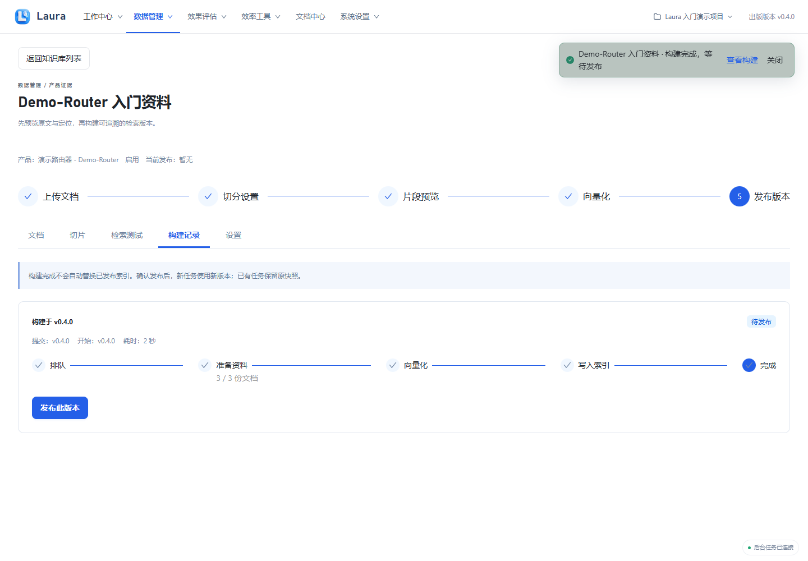
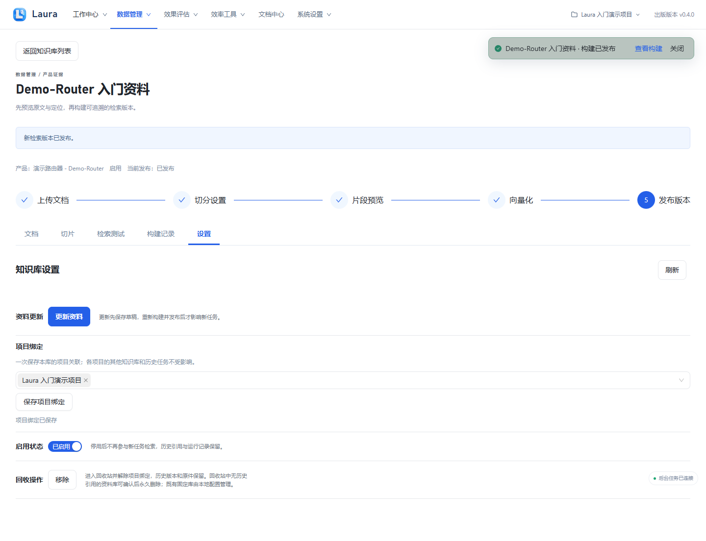
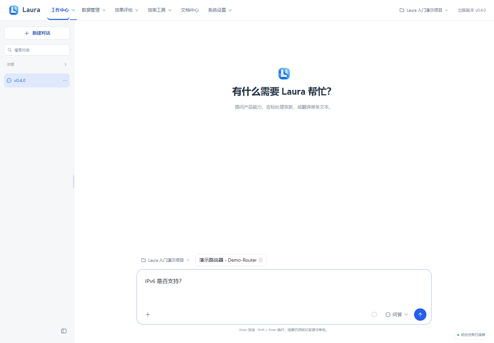
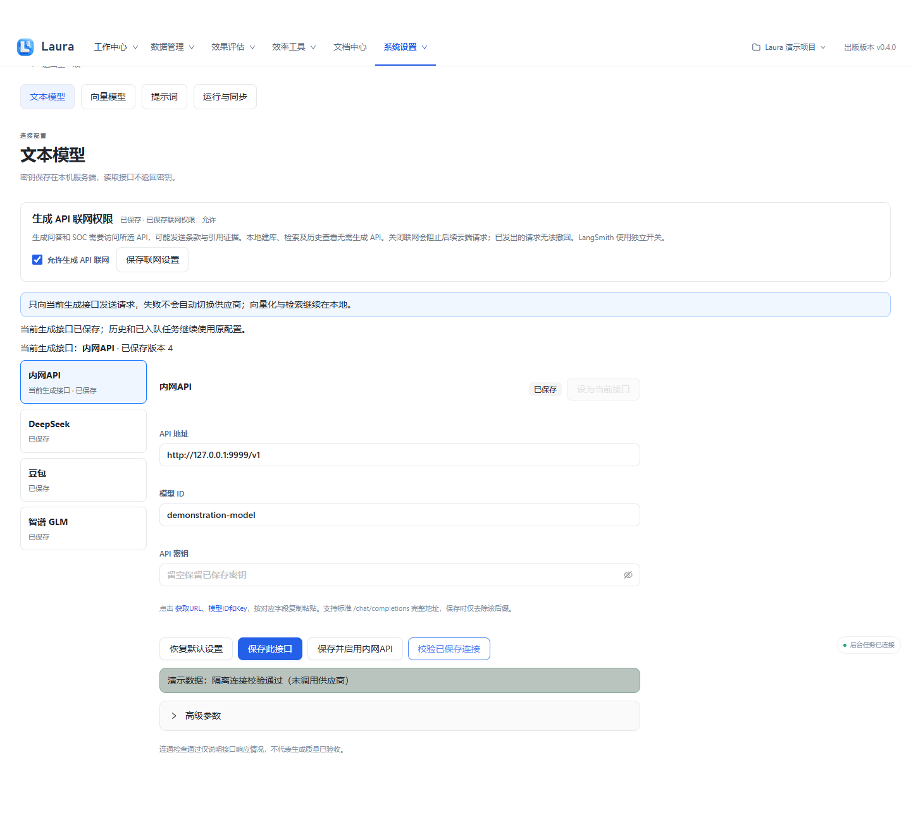
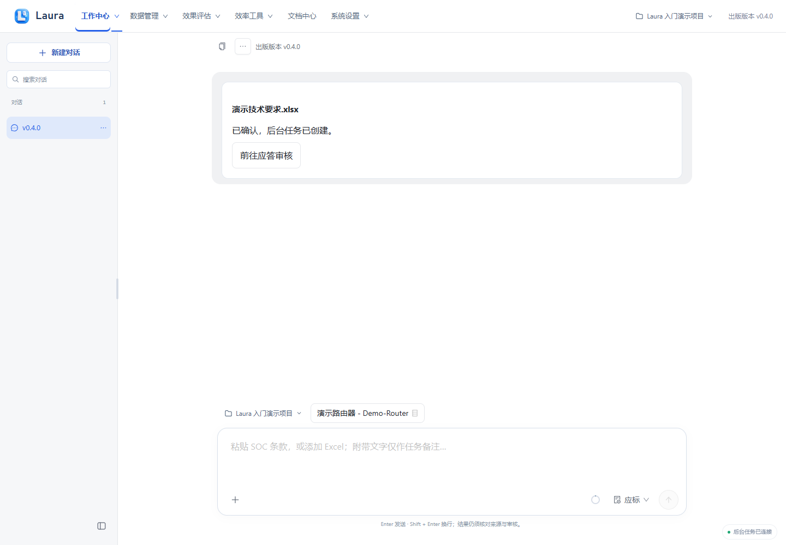
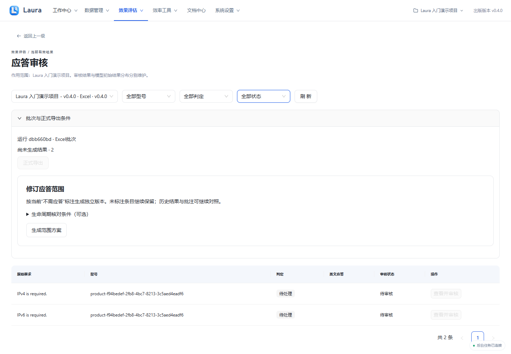

# 常见问题

出版版本：v0.4.0

## 当前版本补充

“本次校验未发送请求”表示生成 API 联网许可尚未开启，不是公司 URL 或 Key 的验证结果。开启前核对目标地址，主动允许后重新校验已保存接口。旧任务若受原授权快照限制，应在授权后重新创建任务，不能静默改变旧任务的发送许可。

公开版文档仅分发使用与现行设计说明，历史归档与开发/验证记录保留本地。项目误回收后可在项目管理的回收站恢复。

> 所有截图来自隔离演示实例，使用合成产品、资料、模型结果与四维向量替身；不包含真实业务数据或密钥。真实模型质量、准确率和业务验收仍需另行验证。

[前往知识库](laura:knowledge)。此入口只切换页面，不自动创建任务；离线 HTML 请回到 Laura 使用相应导航。

## 1. 上传了但问答没有使用资料

在知识库“构建记录”检查是否只有构建完成；确认就绪后点“发布此版本”。不要把上传成功或切片预览当成已发布。

**应看到：** 正常参考图显示可发布版本；实际已发布后才成为检索来源，未发布时不应指望新任务使用草稿。

## 2. 已发布仍未参与项目

打开知识库“设置”，核对“绑定项目”中包含当前项目，点“保存项目绑定”，同时确认“启用知识库”。

**应看到：** 正常参考图显示绑定与启用入口；仅绑定、仅启用或仅发布其中一项都不充分。

## 3. 型号不匹配

回到工作中心，核对输入区“本次任务型号”，再对照知识库基础信息中的产品名称；不要用相似型号或别名猜测能力。

**应看到：** 正常参考图中项目与 Demo-Router 一致。型号不一致时先选择正确型号或准备相应资料。

## 4. 模型校验失败或无法生成

在系统设置 → 文本模型核对 API 地址、模型 ID、已保存密钥及当前接口，再点“校验已保存连接”；检查生成联网权限。

**应看到：** 图片展示连接检查入口及合成通过提示。实际失败时以实际返回信息排查，不照搬演示通过结果；连接通过也不证明回答质量。

## 5. 知识库构建失败

打开知识库“构建记录”，核对本地向量模型与切片规则；查看实际错误说明。失败记录允许重试时点“重试构建”，规则改变则先重新预览。

**应看到：** 本图为正常构建页参考，没有制造真实失败。失败时保留原件和草稿，构建未就绪不能发布。更换向量模型需建立并发布新索引。

## 6. 任务中断或停止推进

先从会话任务卡“前往应答审核”定位原任务，在运行日志核对状态、失败环节、Worker 与模型连接。恢复后依据原任务允许的操作处理，输入或映射变化时重新核对。

**应看到：** 图片展示正常任务卡入口。中断不等于处理完成，不要直接交付部分结果；避免反复发送创建重复任务。

## 7. 正式导出受阻

在应答审核检查尚未审核、UNKNOWN、证据失效、型号冲突、无效口径和映射原因；先补证或修正，再重新处理与审核。

**应看到：** 本图真实展示尚未审核时禁用的正式导出按钮。UNKNOWN 不能通过人工批准变成无证据的正式承诺，翻译也不走 SOC 四态审核。

如果右下角构建通知遮挡操作，可先点击通知中的“关闭”，再继续。关闭通知不会撤销已提交构建或已发布版本。

## 8. 更新与旧版本升级

### 已使用 v0.4.0 或后续版本

从顶部或系统设置打开“检查更新”，也可双击原目录中的“检查更新Laura.cmd”。由你主动检查后，应用从项目 GitHub 下载并校验新版，页面显示版本及下载进度。准备完成后核对目标目录并点击“安装并重启”，经过明确确认才替换程序；检查和下载本身不启动业务模型请求。

检查更新需要能访问 GitHub，与生成 API 联网开关独立。关闭生成 API 联网不会替代更新服务的访问控制，检查更新也不会授予条款和证据的生成发送权限。网络或校验失败时按页面提示重试，不使用来源不明的文件绕过校验。

### 从 0.3.x 首次升级

旧版没有更新入口，需要先下载并解压一次 v0.4.0 完整包。运行新包中的“检查更新Laura.cmd”，选择原 Laura 目录，由更新工具使用新包升级原目录；无需手工搬运知识库或对话。以后使用页面或原目录脚本更新即可，不需要反复下载完整包来搬数据。

### 任务保护与数据保留

存在排队、运行或取消中任务时会阻止安装，不强制取消任务。先等待结束或在原任务中按支持的流程处理，再重新检查。安装前自动备份知识库、对话、记忆、模型及配置；保留原目录与用户状态，数据继续留在既有目录，不迁移到用户 AppData。

备份保存在原目录的 `.laura-backups`，属于本机用户数据，不上传 GitHub。更新失败时工具回滚程序及 SQLite、配置备份；失败后先查看提示并保留备份，不反复手工覆盖正在使用的数据库。此机制不构成对任意断电或磁盘损坏的恢复承诺，重要资料仍应按自己的备份制度管理。
