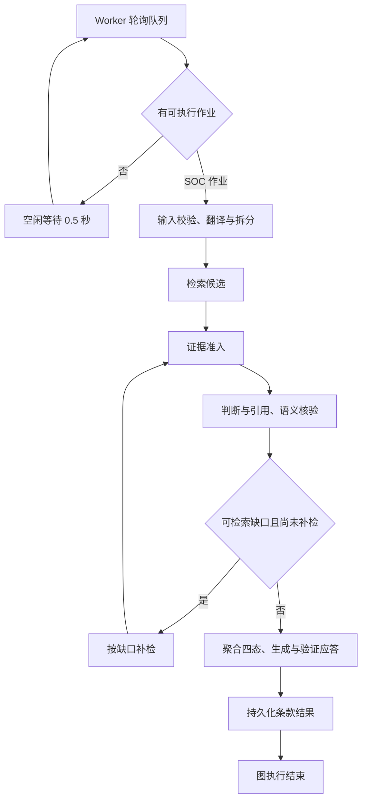

# Agent Loop

出版版本：v0.4.6

Worker 轮询本地队列，领取可执行作业。SOC 单条任务和 Excel 批任务使用同一张条款状态图。批任务由 Worker 逐条执行，每条以 `run_id:clause_id` 建立图线程。普通产品问答走独立流程。

## 条款循环

一次业务回合是对一个条款运行状态图。首轮检查 Claim 是否覆盖原文，再逐项取证、判断、核对引用和语义。图最多补检一次，只有选到新候选的子项会进入补充判断。目标阈值、项目配置等输入缺口要由审核者补齐。当前条款结束后，Worker 继续处理同一作业的剩余条款，再更新作业状态并轮询队列。

## 停止和异常

- 正常路径经 `commit_result` 到 `END`。图有步数上限，模型网关另行约束单个调用的重试。
- 缺证、覆盖不完整或校验失败以 UNKNOWN 保存原因。明确反证按子项进入四态聚合。
- 用户取消或联网权限暂停时，由 Worker 处理作业状态。图结束后的审核及 Excel 回填由独立流程执行。

状态图与分支 · [调度与恢复](07-Harness.md) · [工具执行和错误](03-Tool.md)
