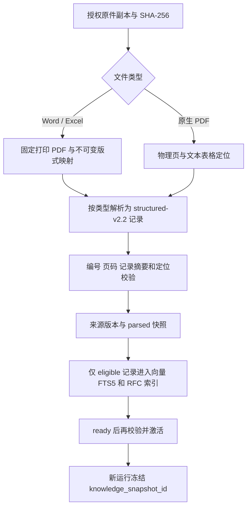
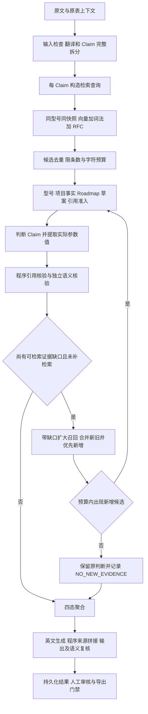

# RAG 设计

出版版本：v0.4.2

**当前方案是“类型化记录入库＋同型号混合检索＋程序准入＋逐项判断与复核”。检索命中只提供候选，不能直接推出支持或不支持。** 当前配置快照中的工作流版本为 `SOC 固定工作流`，知识解析版本仍为 `structured-v2.2`。两者是不同版本维度：修改参数判定或检索预算，不等于重新解析、重建了知识库。实现：任务快照、结构记录、SOC 节点。

## 1 设计目标与当前状态

设计目标是让每个产品事实都能回到固定来源、完整业务条目和真实页码；让预算、准入与失败原因可检查；证据不足时保留 UNKNOWN。确定性解析负责保留原件，模型负责受约束的语义判断，程序负责引用、数值及交付门禁。这个目标不意味着已经证明整体召回率或真实应答准确率。实现：结构解析、来源校验、判定链。

| 状态 | 截至本版的含义 | 证据 |
| --- | --- | --- |
| 已实现 | 结构化解析、不可变打印 PDF、FAISS/FTS5/RRF、RFC 精确入口、候选限额、缺口补检索、参数真值校验、生命周期例外、运行快照冻结 | 当前规则见对应设计章节 |
| 待验收 | 当前版本在完整要求值、固定应答范围下的真实全链路质量、召回覆盖及成本；多型号表格与图形含义 | 需独立人工样本和真实调用验收 |

## 2 两条数据链路

建库与应答使用同一组来源版本，但生命周期不同。建库先准备完整文件和索引再激活；新任务固定当时的快照 ID，已有任务不会因新索引激活而自动换库。以下为当前实现流程。实现：建库脚本、知识服务、任务服务、SOC 图。

## 3 授权来源与结构化入库

### 3.1 来源边界

资料须由使用者确认使用权、具体产品及来源类型。产品说明、功能清单、标准清单、规划与其他文档分别标记；同系列或相似型号资料不能自动合并到本次产品。Excel 原始字段是事实来源，打印 PDF 只补充固定页码，不能替代原始单元格含义。公开发行不包含作者的原始资料、历史建库报告或预置产品知识。

`KnowledgeService.ingest` 只接受授权路径，复制到受控来源目录并复核 SHA-256。相同文件哈希、产品、文档类型和解析指纹可复用有效来源版本，撤销来源不能自动重建成有效证据。固定来源清单的编号范围属于发布约束，资料增补后须重新审查，不能为通过校验补造条目。用户新增库走第 10 节的显式预览、构建与发布链。

### 3.2 切分规则

| 文档与原子单位 | 当前处理 | 不能据此推断的内容 |
| --- | --- | --- |
| Product Description 正文 | Word 按 Heading/标题栈；PDF 以书签和正文匹配建立标题路径；按页组织，长正文按 300 个空白分隔词切分，重叠 35 词 | 空白词数不是模型 token 数；不自动解释图片或拓扑 |
| Word 描述表格 | 每行一个 `table_row`，重复保留表头，保留标题及页码 | 一行出现多个子型号时不能默认都适用 |
| PDF 描述表格 | 几何识别表格，正文与表格分离；每个表格保留列矩阵为 `description_table` | 不能声称复杂表格已完整做语义行列配对 |
| Feature Index | 一条逻辑功能记录；继承分类，数字编号开启记录，空编号续行合并；保留原始与规范支持值 | `Support` 不是容量或数量 |
| Performance Index | 一条逻辑性能记录，固定字段 `category/line_no/metric/value`；保留完整值 | 不用指标名称创建动态 JSON 键，不猜单位进制 |
| Standard List | 一个原始编号一条；保留重复 RFC，不补缺字段；PDF 原文没有 category 时保存空值与标记 | 命中某 RFC 不等于满足全部 IEEE/IETF 标准 |
| Roadmap | 一物理页一记录；封面、目录、结束页等仍保存，实质文本页才可召回 | 文字抽取不自动解释颜色、箭头、图形或混合型号列的含义 |

规则来源：统一记录与正文切分、Office 解析、PDF 解析。结构化入库直接使用上述记录；旧版 `chunk_blocks(max_chars=1800)` 仅保留兼容用途，原子功能、性能、标准和表格记录不会按该字符阈值截断。兼容切分、入库选择。

### 3.3 记录字段契约

| 字段 | 用途和约束 |
| --- | --- |
| `schema_version / parser_fingerprint` | 当前结构版本与包含分页指纹的解析身份 |
| `chunk_id / source_order` | 由来源哈希、产品、文档类型、解析指纹、顺序和记录内容生成 UUID5；同一解析输入可重复得到同一 ID，内容或版式变更会变更 ID |
| `source_sha256 / source_file / product_id / document_type` | 来源、产品与类型身份；不是模型自行生成的归属 |
| `content_type / fields` | 业务字段：feature、performance、standard、description、table_row、description_table、roadmap_page 等 |
| `section_path` | 完整父子标题路径；父标题没有单独正文时仍随子记录保留 |
| `content / text` | 当前两者保存相同的带字段标签证据；含文件、页码、产品、标题和字段，用于展示与逐字引用 |
| `embedding_text` | 产品、标题和语义字段；去除文件名、页码、哈希、绝对路径及 JSON 外壳后用于向量化 |
| `locator` | `kind`、`page_start/page_end`、`physical_page`、`page_source`、`section_path`；按文件类型另有 `sheet/row/row_end/cells/table/paragraph/part/rendered_pdf` |
| `retrieval_eligible / quality_flags` | 是否进入召回及缺字段、跨页续行、规划性质等标记；质量标记不自动升级为已核验结论 |
| `content_hash` | 当前文本内容摘要；来源版本另存整组 `records_digest` |

字段与稳定 ID 的实际构造见 structured.py，运行引用对象 `EvidenceRef` 和定位对象见 core.py。`fields` 保留结构事实，模型实际接收的是带标签的 `quote`，不是完整 JSONL 记录；引用中的原文可为整条内容的逐字子串。证据构造与核验。

### 3.4 不可变 PDF 与发布门禁

Word/Excel 页码来自保存的打印 PDF；Excel 同时保留 Sheet、原始行范围与单元格。物理页与原件印刷页不是同一概念，印刷页不明时不猜。Office 缺少有效分页映射时拒绝解析；PDF 产品描述没有可核验书签或书签不能匹配正文时拒绝处理。定位实现、结构解析、PDF 标题检查。

定位产物存放于 `data/knowledge/rendered/<原件哈希>/<版式指纹>/`。哈希目录中的 `pagination.json` 是后续入库使用的最新指针；历史 `locator.rendered_pdf` 指向不可变版式路径。重印可以创建新布局，但同一版本不能覆盖成另一份 PDF；页数、原件哈希和 PDF 哈希不符会拒绝使用。发布与加载。

预处理、入库、建索引、激活均有完整性校验：非空记录、唯一 ID、真实页范围、配置编号逐项覆盖；Roadmap 校验完整物理页覆盖。建索引和激活再次检查实际数据库记录的摘要及固定 PDF，不能仅依赖此前生成的报告。`parsed` 不等于可激活，结构化快照须完成索引并成为 `ready`。共同校验、知识服务、索引构建。

单型号构建先写 FAISS 与清单，再在事务中写 FTS/索引元数据及激活；双型号脚本先使两者都 ready，再用一次数据库事务切换两个活动头。旧版本不因切换而删除。文件写入和数据库不是同一个跨介质事务，构建失败可能留下未激活文件，但不会因此替换旧活动快照。单型号实现、双型号脚本。

## 4 向量化与索引

当前本地配置使用 Qwen3-Embedding-0.6B，日常设备为 CPU，`max_length=1024`、`batch_size=4`。加载只使用本地文件，关闭在线下载和遥测，`trust_remote_code=False`。指定 CUDA 但不可用时明确报错，不暗中回退为 CPU。配置、Embedding 实现。

长记录不会丢弃尾部：先按 tokenizer 切窗口，窗口预算为 `max_length - 查询指令token数 - 32`，窗口重叠为 `min(64, budget//4)`；每窗口编码、归一化，再对同一记录的窗口取均值并归一化，最终仍为该记录一个向量。查询前缀为固定技术要求检索指令，文档不带该查询指令。窗口均值保留尾部参与表示，但不能保证长条目每个事实都同样容易被召回。实现。

| 索引 | 当前实现 |
| --- | --- |
| 向量索引 | FAISS `IndexFlatIP`；float32、L2 归一化，按快照独立保存 |
| 词法索引 | SQLite FTS5；`product_id + snapshot_id` 双过滤，BM25 排序；英文/数字词、中文单字与双字片段 |
| 精确入口 | 只实现 RFC 标识符规范化，如 `RFC 4742`、`RFC-4742`、`RFC4742` 归一为 `rfc4742`；清单保存 term→chunk ID |
| 混合排序 | RRF：每个榜单贡献 `1/(60+rank)`，rank 从 1 开始；同分先词法顺序，再 ID |
| 指纹 | Embedding 必需文件哈希、归一化、查询指令、最大长度、窗口策略与切分版本；查询时指纹/产品不匹配拒绝使用 |

实现见 indexes.py、retrieval.py、embeddings.py。当前没有独立 reranker、LLM 查询改写器或通用图形理解入口；对其他标准号的支持来自词法/向量，不应泛称“全部标识符都有精确索引”。

## 5 SOC 检索路由与全部预算

### 5.1 查询怎么构造

每个 Claim 单独检索，查询由以下内容顺序组成：Claim 原文；原表前置标题和允许的邻列文字；参数型要求的实际值/单位/适用条件提示；补检索时再加本 Claim 的缺口说明前 600 字符。标准相关补检索追加“只核对原要求的标准范围，草案不等于正式 RFC”的提示。原表上下文用于描述需求，不能成为产品事实证据。查询构造、上下文裁剪。

普通上传、范围修订和旧任务新运行共用要求上下文构建；要求值、单位及比较方向单独保存于 `source_context.requirement_values`。原表阈值被删掉时，系统不能从旧 UNKNOWN 或投标应答列恢复要求；人工批注和旧结果也不得进入事实证据。输入上下文与读取边界见 requirements.py、source_context.py、任务刷新。

### 5.2 首轮与补检索预算

下表按当前 `retrieval_top_k=8` 推导。候选数、字符数和 token 数是三个不同预算，不能互相替代。配置、processing.yaml、底层检索、候选收敛。

| 阶段 | 首轮 | 补检索 | 作用域 |
| --- | ---: | ---: | --- |
| 向量原始召回上限 | 24 | 48 | 每 Claim、同产品快照，受库内数量限制 |
| FTS 原始召回上限 | 24 | 48 | 每 Claim；查询去重后最多取前 64 个词法 token，以 OR 匹配 |
| RRF 融合集合 | 最多 48 个唯一候选 | 最多 96 个唯一候选 | 尚未加 RFC 精确命中；两个榜单会重复 |
| RFC 精确命中 | 在融合候选前合并去重 | 同左 | 可补入未在两个原始榜单中的同快照命中 |
| Retriever 返回上限 | 8 | 16 | 参数优先排序后截取 |
| SOC 最终候选上限 | 8 | 新旧合并后仍为 8 | `candidate_limit`，不是补检索后累计 24 条送模型 |
| SOC 候选总 quote 字符 | ≤12000 | ≤12000 | `evidence_max_characters`；仅 quote 字符，不含 Prompt、schema 等包装 |
| 补检索次数 | 0 | 每条款最多一轮 | 该轮只处理符合条件的 UNKNOWN Claim |

排序先融合 RRF 与 RFC 精确入口，再对参数查询稳定优先 `document_type=feature_list`；这是已有同产品、同快照候选池内的偏好，不是全库扫描或强制命中。参数优先级可以改变此前 RFC 命中的绝对名次，不能把“RFC 精确命中永远排第一”当成当前所有查询的保证。实现。

SOC 的 `bound_candidates` 按 `chunk_id` 合并去重，补检索先排新增候选，再在新/旧组内考虑 Feature List 偏好，稳定保留组内顺序。逐条检查总数与字符预算：超限的整条候选跳过并记录 ID，不截断原子证据。这意味着很长的相关条目可能完全未进入模型，新增候选也可能挤掉旧证据；预算控制不是召回质量保证。实现与边界测试、。

### 5.3 何时补检索

补检索必须同时满足：未发生致命错误、尚未补过、Claim 为 UNKNOWN、理由码属于 `EVIDENCE_MISSING / INSUFFICIENT_EVIDENCE / EVIDENCE_INSUFFICIENT / STANDARD_DRAFT_ONLY / PARAMETER_VALUE_MISSING`，且 `gap_type=evidence`。缺阈值的英文或中文说明还有保守文本检查，避免旧结果未标明类型时重复查库。条件实现、节点路由。

缺要求值、项目履约事实、型号/配置范围或冲突不靠扩大产品库召回解决；不在白名单的失败也不自动补检索。补检索后，只有预算内选中了首轮没有的 chunk ID，才重新执行该 Claim 的准入、判断与复核；否则记录 `NO_NEW_EVIDENCE` 并保留原判断。这里的“新增”检查发生在准入前，不保证新增资料一定可用或改变结论。实现、。

### 5.4 与模型预算及运行冻结的关系

| 配置或限制 | 当前值/行为 | 来源 |
| --- | --- | --- |
| `retrieval_top_k / rrf_k` | 8 / 60 | local.yaml |
| `candidate_limit / evidence_max_characters` | 8 / 12000 | processing.yaml |
| `judge_claim / verify_semantic_support` | 思考策略 auto，输出上限 4096 | processing.yaml |
| `render_response` | 思考策略 disabled，输出上限 4096 | processing.yaml |
| 模型尝试额度 | 所选 API 新运行按 run＋clause＋claim＋逻辑节点累计最多两次总尝试，不自动切换供应商；旧主备快照仅保留兼容解释 | gateway.py |
| 补检索与恢复 | 不重置同一逻辑节点的尝试额度；补检索调用和网络重试分别记录 | nodes.py、gateway.py |
| 上下文限制 | 模型配置当前为 32000；网关用字符估算预检，非精确 tokenizer 计数 | models.yaml、gateway.py |

思考模式字段当前由网关对 DeepSeek 分支应用；不能把 YAML 的配置意图等同于所有供应商都已验证相同行为。12000 quote 字符也不能保证最终请求不触及模型上下文/输出限制，条款包含多个 Claim 时最终英文语义复核还会汇集它们的已引用证据。网关配置合并、最终输出复核。

入队和新运行时保存模型、Prompt 内容、产品配置、processing、检索及 Embedding 配置、知识快照 ID 和工作流版本的不可变配置快照；Worker 从该快照构造检索器和节点设置。恢复沿用旧运行；新运行才采用新配置。仅修改全局文件不会重算历史结果，也不能让旧运行获得新的预算规则。冻结入口、Worker 恢复配置。

这里冻结的是输入与配置数据，代码、输出 Schema 和规则实现没有随快照保存成可独立执行的版本。恢复历史任务时仍运行当前程序；`workflow_version` 是记录标签，不是旧代码加载器，因此不能据此声称任意历史运行都能严格重现。运行入口、节点与 Schema 调用；

## 6 证据准入与结论收敛

SOC 首先移除含不可信指令的候选，再检查产品 ID、项目事实类别、Roadmap 用途、段落/表格适用型号、标准草案和引用真实性。来源文件属于 M6000-SE 系列仍不足以证明某个具体机框；Word 表格数值行会补查同来源同表格的前 3 行以恢复子型号列头。节点准入、准入规则、产品适用范围。

| 条件 | 当前处理与主要理由码 |
| --- | --- |
| 任务与证据产品不一致，或证据明确限定其他子型号 | 拒绝，`PRODUCT_CONFLICT` |
| Claim 需要真实供货、许可证或已提交文件等项目履约事实 | 产品手册不能替代，`PROJECT_FACT_MISSING`；能力询问不应误归为履约事实 |
| 当前能力只找到 Roadmap | 拒绝，`ROADMAP_ONLY`；生命周期特例见下一节 |
| 要求 IETF/RFC，候选只含 Internet-Draft/draft-ietf | 拒绝，`STANDARD_DRAFT_ONLY` |
| 来源被撤销、固定 PDF 变化、locator 不一致或 quote 非原文子串 | 拒绝，`CITATION_INVALID` |
| 没有候选也没有更具体拒绝原因 | `EVIDENCE_MISSING` |

主要理由码来自 admission.py、项目事实分类、引用核验。准入函数另有 `required_version` 检查能力，但当前普通 SOC/QA 调用没有传入该参数，不能宣称所有软件版本要求都已由这个硬门禁核对；具体版本与条件仍需 Claim 判定和语义复核。调用位置、QA 调用。

通过准入后仍依次执行：模型判定完整 Claim；引用只能选已准入 chunk，quote 必须逐字存在；程序再次核验来源/定位/原文；独立模型复核证据是否支持整个判断。语义复核的 SUPPORTED 表示“证据支持该判定”，也包括反证支持 CONTRADICTED，不等同于“产品满足需求”。语义不支持或无法确认会降为 UNKNOWN。节点实现、语义复核 Prompt。

完整覆盖且全部支持才是 FC；明确支持与明确反证混合为 PC；全部明确反证为 NC；任何 UNKNOWN、覆盖不全或校验失败均不能得到肯定交付结论。不存在“召回少所以 NC”“相似度高所以 FC”或“审核通过就把 UNKNOWN 放行”的转换规则。FC/PC 英文还要通过输出程序检查与最终语义复核。四态聚合、输出检查、节点实现；审核与正式导出规则见 [PRD](../01-产品与路线/PRD.md)。

### 6.1 Roadmap 的生命周期例外

Roadmap 实质页可以进入检索，但未来功能规划仍不能证明当前交付能力。当前只对明确生命周期事件开放窄例外：`reference_date`、`exact_model`、`source_version_id` 齐备且与证据一致；原文明确对应具体型号；无混合型号；只有一个可识别日期，且紧随所要求的生命周期事件标签，不能使用 GA/功能发布时间代替 EOL。规则、准入顺序。

期限型要求还需明确“至少/不少于/不早于”或“不在未来 N 年内结束”等比较含义。季度日期按该季度最早日期保守核验；无法唯一配对事件、日期、型号或满足期限时继续拒绝。即使准入，也必须走判断与语义复核，不自动得到 FC。项目“投标人已提交生命周期承诺”仍属于项目事实，不由 Roadmap 证明。生命周期实现、。

生命周期上下文由范围修订方案保存进输入快照，Worker 再恢复；普通任务创建接口当前不会自动生成这些条件。缺上下文时规则返回 `LIFECYCLE_CONTEXT_MISSING`，不能靠当前日期或系列选择偷偷补齐。范围方案、任务入口、Worker。

### 6.2 参数实际值与功能支持分开

参数要求依据数值及单位、比较词、容量/数量/尺寸等表达或原表要求值识别；数值范围和 Class B 等明确等级仍属于参数。`monitor/limit the number of` 没有真实阈值时可能只是功能，`minimum SNMP/XML` 也不是要求提供容量。混合条款不能因某一行有阈值就要求每个布尔子 Claim 都填数字。识别与作用域、、。

| 字段/输入 | 含义 | 核验规则 |
| --- | --- | --- |
| `source_context.requirement_values` | 用户要求的阈值、单位和比较方向 | 仅用于比较，不是产品值 |
| `parameter_values[].name` | 实际指标或等级名称 | 与 Claim、型号及条件一起语义核对 |
| `actual_value / unit` | 引用中的实际值及单位 | 逐字核验且有边界；512 不能匹配成 5120；Support/Yes 等被过滤 |
| `conditions` | 原文中的适用条件 | 非空时必须存在于被引 quote 中，不能自行改写成真值字段 |
| `evidence_chunk_id` | 实际值对应的已引用证据 | 必须属于当前判定的引用集 |

字段见 schemas/core.py。对 Feature List 引用，若包含 `Value:` 行，实际值优先只在这些值行里核验；`Source/Page/Product/Line No./Row/Version` 等元数据不作实际能力值。找不到真实值的参数型肯定结论降为 `PARAMETER_VALUE_MISSING`；不匹配则为 `PARAMETER_VALUE_INVALID`。普通功能 Claim 丢弃多余参数字段，但仍独立核验功能语义；原本 UNKNOWN 的真实缺口不会被可选参数字段错误覆盖。程序校验、judge_claim。

参数比较不能由通用代码替代全部业务语义：K/M 进制、系列最大值与当前配置、比较方向和条件仍由受约束判断及语义复核检查，歧义未消除时保持 UNKNOWN。英文应答须写产品实际值和必要条件，程序根据已核验引用生成来源段；要求值不能冒充能力值，来源页码不能充当数值答案。判断 Prompt、语义 Prompt、输出契约、输出校验。

## 7 产品问答与 SOC 的实现差异

两者复用 HybridRetriever、来源版本和引用核验；产品问答是较短的独立路径，不能以 SOC 全链路保障来描述它。QA 实现、SOC 实现。

| 行为 | PRODUCT_QA | SOC_SINGLE / SOC_BATCH |
| --- | --- | --- |
| 查询单位 | 用户问题整体；历史仅给回答模型，不参与本次检索查询 | 每个完整 Claim＋原表上下文＋必要参数/缺口提示 |
| Retriever | 首轮最多 8；有同产品快照过滤、混合排序和底层参数偏好 | 同一检索器，补检索最多 16，再由节点收敛 |
| SOC 的 8 条/12000 字符再筛选 | 未接入 `bound_candidates`；没有该 quote 总字符门 | 已接入 |
| 准入 | 产品、引用、不可信内容等共享检查；当前调用未传 `claim_text/project_fact` | 传 Claim 文本及分类，执行标准草案、项目事实和生命周期分支 |
| Roadmap 生命周期例外 | 当前无 claim_text，Roadmap 保持拒绝 | 满足全部生命周期上下文后才可进入判断 |
| 参数值与补检索 | 未执行 SOC 参数真值校验或缺口补检索 | 按参数及缺口规则执行 |
| 语义复核与四态 | 生成答案、逐字引用校验和 uncertainties；无独立 SOC 语义复核/FC-PC-NC-UNKNOWN 聚合 | 判定与最终英文均有独立语义复核及四态门禁 |
| 结果用途 | 产品证据问答 | SOC 审核和受控导出 |

因此 QA 目前不能提供与 SOC 等同的参数/标准/项目事实保障；它仍要求给出可核验引用，没有引用或引用无效时返回无法确认。上述差异是当前入口调用事实，应列为产品边界或后续改进，不能在文档中视作已经统一。QA 调用与失败返回。

## 8 诊断数据与排查顺序

每条 SOC 结果保存 `diagnostics.retrieval[claim_id]`；节点提交日志保存各阶段输出，便于区分“没执行检索”“召回但未选中”“被准入拒绝”“判断后核验失败”。当前结构如下。写入位置、节点链路 API。

| 字段 | 可以说明什么 |
| --- | --- |
| `queries[]` | 每轮实际 query、supplement 标记、原缺口、Retriever 返回的 `candidate_chunk_ids` |
| `queries[].budget` | 候选数与字符限额、实际字符、合并可用数、预算丢弃 ID |
| `new_selected_chunk_ids` | 最终预算内相对上一轮新增的候选 ID |
| `admitted_chunk_ids / excluded_chunk_ids / rejection_reasons` | 准入后的集合与原因；不可信候选先被过滤，其原因另附 `UNTRUSTED_INPUT` |
| `project_fact / project_fact_classification` | 产品能力和项目事实的实际分类 |
| `parameter_validation` | 是否需要实际值、忽略的多余功能字段数、参数错误码 |
| `remaining_gap / assessment_reason / supplement_eligibility` | 最近一次 judge 阶段的缺口、理由与补检索资格 |
| `before_supplement / supplement_skipped` | 补检索前判断及无新增证据等跳过原因 |
| `diagnostics.output_validation` | 最终英文程序检查问题、生成文本与最终语义核验 |
| 节点耗时与模型 attempts | 首轮/补检索/网络重试、有效配置、截断/结构错误、已知用量和缺失用量 |

这些数据尚不等于完整排名解释：Retriever 未持久化向量相似度、FTS BM25 分数、RRF 分数和整个融合榜单；`candidate_chunk_ids` 是 Retriever 截取后的返回项。准入/判断字段可能被补检索阶段更新，`remaining_gap` 也不是后续语义核验的最终结论；逐轮还原应联合 `queries`、`before_supplement` 和节点提交记录。检索返回、诊断更新、trace/export。

排查时先看失败节点和输入要求是否完整，再看查询、候选和预算丢弃；随后核对准入、参数值、引用和语义复核，最后看英文输出。拆分阶段失败不能归为知识库没召回，缺 D 列阈值不能用扩大 top_k 修复，拒绝多型号 Roadmap 也不能简化成“Roadmap 没有索引”。真实案例和统计放在 运行观测与评测 。

## 9 操作入口与验证边界

### 9.1 产物与重建顺序

| 产物 | 用途 |
| --- | --- |
| `data/knowledge/source_manifest.json` | 原件复制及使用范围 |
| `data/knowledge/originals/` | 原件副本 |
| `data/knowledge/rendered/<sha>/<layout>/` | 固定 PDF 与冻结分页映射 |
| `data/knowledge/structured/<product>/chunks.jsonl` | 可人工检查的结构记录 |
| `validation_report.json / samples.json` | 预处理校验和指定样例 |
| `build_report.json / retrieval_report.json` | 特定时间的构建与指定检索检查，不能代替当前 active 状态 |
| `data/indexes/<snapshot_id>/` | FAISS 与快照清单 |
| 数据库 `source_version / chunk / knowledge_snapshot / knowledge_head` | 来源、记录、快照与活动指针 |

产物生成逻辑见 准备脚本、渲染脚本、构建脚本、知识服务。源文件更新时按“准备原件→固定页码→结构校验→新索引→激活→检索与业务样例验证”执行；现有库日常查询不需要重复全量重建。启动和具体命令集中维护在 项目 README。

构建应使用明确的本地运行时、设备与模型指纹。向量缓存由文本和 Embedding 指纹命名，读取时校验输入与输出哈希；缓存存在不证明当前资料已发布或具备检索质量。

### 9.3 验收需要分层

| 层次 | 应验证的内容 | 当前证据边界 |
| --- | --- | --- |
| 结构与定位 | 合并续行、编号、缺字段、页范围、不可变重印、旧引用兼容、发布时重验 | 验证应覆盖当前来源版本；不能继承未重跑的通过结论 |
| 检索与预算 | 型号隔离、RFC、参数池内排序、24/48 召回、8 条/12000 字符、新增候选、无新增不重判 | 程序规则检查不等于完整人工 gold 召回评测 |
| 证据安全与语义 | 子型号/版本、Roadmap 事件、草案、项目承诺、真值/单位/条件和反证 | 复杂原件、图形关系及真实模型须独立审定 |
| 端到端业务 | 完整要求值、真实 OR、功能/参数混合、引用准确、FC/PC/NC/UNKNOWN、最终英文及审核导出 | 需用真实完整输入和人工判据独立验收 |
| 成本与性能 | 同输入范围、同知识快照和人工判据下的时间、调用、Token 与错误肯定 | 不能用字符节省或不同分母运行推导同质量成本收益 |

相关测试入口：、、、、、、。测试执行记录、真实批次和后续验收统一见 运行观测与评测。

后续业务验收应先恢复原始要求值、单位、标题和已核对的应答范围，按少量人工审定的完整链路样本覆盖参数、功能、OR、标准、缺证据和明确反证，再进行同口径批次对照。尚未实施或证明的改进包括完整检索排名诊断、复杂表格/图形语义、QA 与 SOC 保障的统一、固定 gold 下的真实召回与成本优化；它们不属于本版已完成能力。、当前检索实现、QA 实现。

## 10. 可管理知识库、切分与发布

既有配置库仅作兼容；使用者新增产品库按 DOCX 章节/段落/表格、PDF 页、XLSX 指定工作表/表头/内容列/参数列/范围预览切片，并保留原文定位。扫描 PDF 返回 OCR 提示；XLSX 公式要求固定值；新上传 DOCX/XLSX 无需 Office 转 PDF。

切片预览不执行向量化。明确确认构建后由单并发 Worker 使用选定本地 Embedding 生成新索引，完成再显式发布；失败可重试。当前 V2 不启用云端向量化；旧云端档案仅保留历史兼容。已有本地模型只从本机加载，不自动下载；长输入使用现有窗口计算或明确拒绝后重切分，不静默截断。

增量构建保留未替换的有效文档，停用文档须重建并发布；历史快照保留。项目明确绑定后仅检索匹配型号的绑定库；未显式绑定的历史项目继续兼容原固定库。运行冻结库版本与 Embedding 配置，不能在查询时混用不同模型向量。引用仍校验原件 hash 和定位，上传成功不是证据已证实。

固定集评测与业务项目范围分别管理；新增知识库应通过明确绑定的项目任务和库内检索验证，不能假设评测自动使用全部项目库。

### 10.1 切分策略与模板

| 策略 | 当前规则 |
|---|---|
| 完整叶标题小节 | 识别 Word 标题样式、大纲及继承；各分支最末级标题的小节为逻辑片，保留段落、表格和文字注释顺序；前言/父级导语单独保留，纯父标题进入路径 |
| 段落合并 | 按长度和重叠组合相邻段落；保留各段定位 |
| 固定长度 | 按长度及重叠切分，保留原文范围 |
| 自定义字面分隔符 | 分隔符为明确边界；超长段内使用长度及重叠规则 |
| Excel 按记录 | 固定工作表、表头、内容/参数列及行范围，保留单位和单元格位置 |
| 保留原始文档 | DOCX／文字 PDF 全文作为一个逻辑片段，保留有序定位和全文范围，不按标题或长度拆分；Excel 不适用 |

叶小节不再次按字符阈值拆碎，一逻辑片对应现有本地滑窗聚合的一条向量；默认本地档案逻辑片上限 12,000 字符，不等于内部 Token 窗口。自建档案显式上限仍生效，预览、构建提交及增量保留来源一致校验；超限阻止构建，未识别标题提示改用段落策略。其他文本策略默认 1,000 字符、范围 100—12,000，默认重叠 0 且必须小于长度。

模板创建/修改/删除与文档规则分离，加载时复制规则；改动要求重新预览。有效规则、模板及解析版本冻结，历史不随模板改写。定位支持有序多段、多表行及段落范围，兼容旧引用；保留向量算法指纹，不自动重切已发布来源。旧 default/excel 策略按原版本兼容。

新增来源类型 `other`（其他）仅表示类别，沿用证据准入与规划资料限制。整篇策略使用 `wizard-whole-document-v1` 解析版本，复用现有本地向量窗口聚合；字符上限仍由向量档案决定，预览和构建都拒绝超限，不自动截断、拆分或回退。原件与已发布来源不改写，详见[专项设计](../03-界面与交互/知识库来源类型与整篇保留策略设计.md)。
