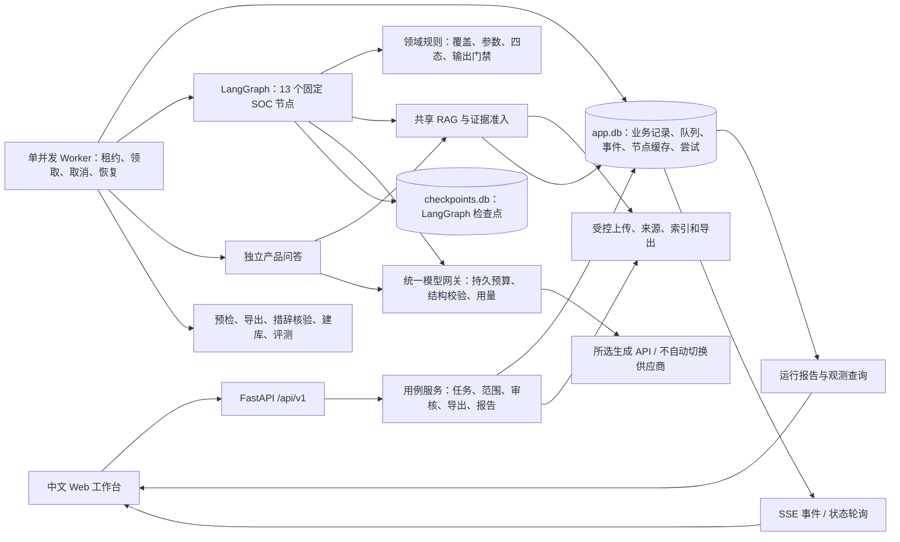
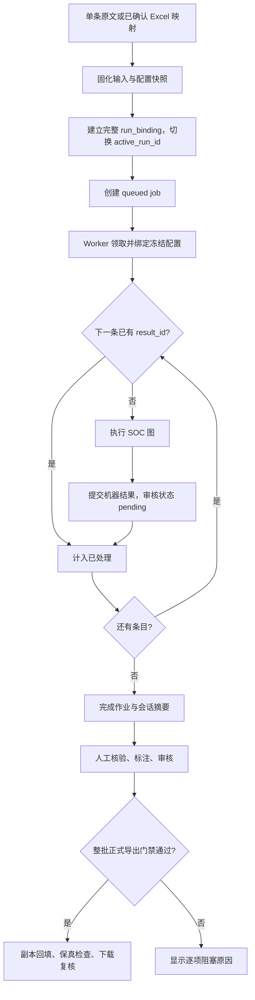
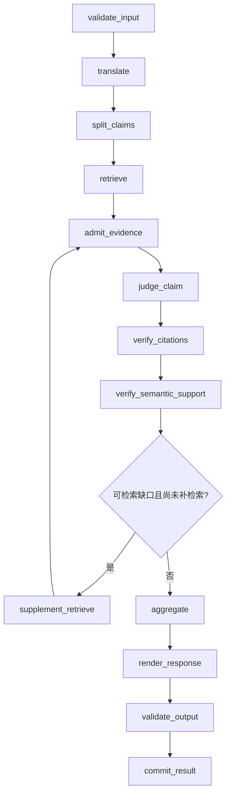

# SOC 投标助手架构设计

出版版本：v0.4.0

本说明保留当前固定工作流、持久化、来源版本和后续模块的技术契约；工程验证不等于业务质量验收。

产品范围见 [PRD](../01-产品与路线/PRD.md)，检索与来源细节见 [RAG设计](RAG设计.md)，依赖与取舍见 [技术栈选型](技术栈选型.md)，指标口径见 [运行观测与评测](../05-质量与验收/运行观测与评测.md)，验证证据与未闭环事项 和 [计划书](../01-产品与路线/计划书.md)。

## 1. 系统形态与核心边界

系统是运行在本机的、证据优先的投标应答工作台：浏览器提交要求，API 固定输入和配置，独立 worker 按固定流程查证、判断与生成；用户核对当前结果版本，服务器满足整批门禁后才生成正式 Excel。当前采用固定工作流，没有自主规划的主/子 Agent，也不执行自动投标。

部署由一个 FastAPI 进程、一个单并发 worker、SQLite 和受控文件目录组成。worker 一次处理一个 job，批任务逐条处理，条款内逐 Claim 执行；这是当前实现约束，不是吞吐量承诺。LangGraph 负责 SOC 节点编排，LangChain Core 用于消息构造，产品检索、证据准入、模型预算和审核导出规则由本项目代码实现。

界面层采用统一对话输入与类型化消息，复用后台固定任务链，不新增流式模型接口。`ConversationService` 负责最近页/向早消息、历史 run 富化、QA 历史过滤与 Excel 卡原子确认；预检记录持久保存会话、型号、备注、配置草稿、最新映射及 accepted。确认卡只关联一次任务，mapping 必须属于该卡且为当前有效版本；配置失效先撤销 mapping，再重新预览。任务备注仅保留在元数据，不进入事实快照和模型历史。完成消息按 run_id 与事件类型独立去重，重跑 progress 不能吞掉最终结果。

消息详情通过 `GET /tasks/{id}?run_id=` 固定历史运行；跨任务运行拒绝。历史视图隐藏审核、范围重跑和云同步写入口，原有服务器 RUN_SUPERSEDED 门禁继续生效。文档中心使用独立顶栏、分类树/正文/目录三栏，目录 category 不参与产品 RAG 或模型输入。

必须分开理解三个层次：

| 层次 | 回答的问题 | 当前规则 |
|---|---|---|
| 执行状态 | 本次程序是否处理完毕 | job 可以 completed，同时存在 UNKNOWN 和待审核项 |
| 业务结论 | 必要要求是否有充分依据 | Claim 为 SUPPORTED / CONTRADICTED / UNKNOWN；条款为 FC / PC / NC / UNKNOWN |
| 交付资格 | 当前完整范围能否正式导出 | 服务器计算 export_readiness，人工批准不能替代证据与输出校验 |

UNKNOWN 表示尚不能判断，可能缺证据、缺要求值、存在范围冲突或发生输出错误，不能当作 NC。FC 占比是机器结论分布，不能当作准确率。

## 2. 总体架构与模块职责

| 实际模块 | 职责与边界 |
|---|---|
| API、评测路由 | 本地访问校验、请求 schema、资源读取、幂等入口与 HTTP 错误映射；不让前端直接决定交付资格 |
| services | 完整运行、版本竞争控制、范围修订、审核、导出、报告和配置用例；不把人工备注自动变成产品事实 |
| workflows | SOC 图、节点状态、产品问答与 Prompt 渲染；不自主改变任务目标 |
| domain | 原文覆盖、OR、参数事实、补检索条件、四态聚合、输出和导出规则；业务底线不能只靠 Prompt |
| rag、知识服务 | 来源解析、快照、检索、准入、引用核验；候选片段不自动成为已验证依据 |
| model_gateway | 所选 API 配置、历史主备兼容、持久预算、瞬态重试、结构化输出校验和 usage；不自动跨供应商重试，不为非法结构偷偷调用修复模型 |
| excel | OOXML 预检、映射、要求上下文构建、正式副本回填与审阅报告；不从被删除的列恢复阈值，不改写原件 |
| persistence | 事务、记录归属、版本、幂等、节点提交与检查点；不提供跨两个 SQLite 文件的原子事务 |
| worker | 作业领取、进程租约、边界取消、执行与中断识别；不自动恢复中断任务 |
| evaluation | 隔离数据集、复用 SOC 图、独立评分；gold 不进入执行输入 |
| security、frontend | 本地访问和路径控制；输入、核验与状态展示；前端状态不构成服务器授权 |

源码默认 Prompt 在 prompts，模型共享规则在 skills/soc-evidence.md；共享规则是模型输入，不是自主调度器。非秘密模型、产品、检索和处理预算在 config；运行数据在 SOC_DATA_DIR 指定目录，默认 data。

## 3. 一次运行如何形成

### 3.1 单条与批量入口

单条入口明确选择型号并提交原文。TaskService.enqueue 创建 input_snapshot、config_snapshot、task、run、完整 run_binding 集合和 queued job；API 返回运行/作业 ID，模型工作由 worker 执行。当前创建任务接口必须显式给出 mode，不能把意图辅助描述成已部署的自主路由器。

批任务先经过“上传 → 后台预检 → 选择表头、原文列、输出列和行范围 → 映射预览并确认”，随后使用同一任务入口。build_requirement_clauses 从原件重新构建每行要求上下文，每个 binding 保存原文、原坐标和上下文。worker 遍历完整集合：已有 result_id 的行复用结果，其余逐条调用同一 SOC 图，最后保存会话摘要。

单条原文上限为 12000 字符，节点还检查原表检索上下文长度。型号冲突行形成带原因的 UNKNOWN，跳过该行后续检索和模型工作，其他行仍继续。图内捕获的业务异常会保守提交 UNKNOWN；未捕获的执行异常可使 job failed，不能宣称所有异常都已隔离到行。

### 3.2 当前仍为 13 个固定节点

图定义见 soc_graph.py，节点实现见 nodes.py。**13 个节点不等于 13 次模型调用**：部分节点只执行规则，判定和核验按 Claim 调用，最终英文还要单独核验。

补检索回到准入、判定与核验，因此部分节点会再次进入。supplement_count 限制每条款至多一轮补检索，每个 Claim 至多补一次；没有第二轮补检索。fatal 后除 aggregate、validate_output、commit_result 外，其余节点跳过实际业务处理。

| 节点 | 主要输入 → 输出 | LLM 条件与硬约束 |
|---|---|---|
| validate_input | 原文、型号、上下文 → 诊断或 fatal | 不调用；检查空值/长度、型号和指令注入特征 |
| translate | 不可变原文和上下文 → 辅助中文译文 | 调用；歧义导致 UNKNOWN，译文不替换原文 |
| split_claims | 原文、译文 → Claim、覆盖诊断、work_ids | 调用；程序对齐逐字片段并检查覆盖/OR，不接受改写冒充原文 |
| retrieve | Claim、原表上下文、产品/知识快照 → 候选、查询诊断 | 不调用 LLM；候选受数量和字符预算限制 |
| admit_evidence | 候选、Claim、运行上下文 → 准入证据和拒绝原因 | 不调用；规则修正能力询问/项目义务类别，再做适用性检查 |
| judge_claim | Claim、准入证据、是否需要实际值 → ClaimAssessment | 有证据才调用；无证据直接 UNKNOWN。引用须来自候选，参数须由引用支持 |
| verify_citations | 判定和引用 → 定位、字面、型号检查 | 不调用；当前 locatable/literal_match 共享 verify_reference 的结果，不是两个独立验证器 |
| verify_semantic_support | 完整 Claim、判定、引用 → 支持/不支持/未决 | 仅非 UNKNOWN Claim 调用；不支持或未决降为 UNKNOWN |
| supplement_retrieve | 可补证缺口、旧候选 → 一轮追加候选和新 work_ids | 不调用 LLM；只对新增选中 chunk 的 Claim 追加判断 |
| aggregate | 所有必要 Claim、覆盖/失败状态 → 条款四态 | 不调用；确定性聚合，参数类 FC/PC 还必须有实际值 |
| render_response | 四态、Claim、核验结果 → 英文与可信来源后缀 | FC/PC 调用；NC 固定模板，UNKNOWN 无正式口径；PC 必须列出未满足项 |
| validate_output | 正文、要求、实际值、引用 → 输出有效性和诊断 | 先程序检查；FC/PC 通过后以 __output__ 单独调用语义核验；失败清空口径并转 UNKNOWN |
| commit_result | 完整状态 → 稳定机器结果 ID、binding、事件 | 不调用；结果与该节点提交同一业务事务，重放不重复创建初始结果 |

四态聚合：全 SUPPORTED 为 FC；全 CONTRADICTED 为 NC；有支持和反证且无 UNKNOWN 为 PC；任一必要 Claim 未决、覆盖不全或 fatal 为 UNKNOWN。空 Claim 集合不判 FC。OR 保留为带备选结构的一个要求，不能改成所有备选都必须支持。

### 3.3 问答和评测的差异

PRODUCT_QA 独立执行输入/型号检查、共享检索与准入、问答模型调用和引用核验，再保存会话结果。它不经过完整 SOC 图，不生成正式四态，不参加审核导出；当前也没有 SOC 式的独立回答语义核验节点。

EVALUATION 通过专门入口创建隔离项目与逐例运行，复用 SOC 图、网关和知识快照。执行按输入白名单传入，gold 留给评分器，项目记忆不进入执行。历史缺字段不能伪装完整，具体证据与剩余可复现边界见第 11 节。

## 4. 原表要求、实际参数与英文口径

架构明确分开“招标要求”和“产品实际值”：

| 数据 | 来源与主要字段 | 使用边界 |
|---|---|---|
| source_context | 原工作簿、坐标、前置标题、相邻原始内容、requirement_values | 帮助理解要求，不是产品支持证据 |
| requirement_values | Value/要求值等表头下的 cell、raw_value、unit、comparator | 不从旧结论、投标应答或批注推断；要求值公式须先转成可核对输入 |
| parameter_values | name、actual_value、unit、conditions、evidence_chunk_id | 实际值须匹配已核验引用的能力正文，页码/行号/型号不能当能力值 |
| gap_type | none / evidence / requirement_input / project_fact / scope / conflict | 配合 reason_code 决定补检索与原因分类，不把缺要求值当缺产品资料 |

普通上传、范围修订、旧批任务新运行共用 requirements.py。上下文升级生成新输入快照，不就地修改旧快照。模型只接收 source_context.py 白名单中的原表内容，不接收人工标注结论。源表删掉要求值列后，程序无法恢复该列，应先恢复正确输入。

范围方案只接受绑定当前结果、未过期且标为 not_requirement 的人工标注。准备方案不启动模型；启动时重验任务版本、标注摘要和原件哈希，建立完整保留范围的新运行，当前不继承旧批准。被排除标题的原文可作为必要上下文，人工说明不进入证据。同文件重新上传只提示旧方案，不自动套用排除和批准。

参数规则要求真正的数量、性能、尺寸或等级条目给出实际值；Support/Yes 等布尔词不算参数事实。普通功能项不因模型返回了额外参数字段而被强制复述这些字段，多 Claim 行的 D 值也不要求每个布尔子项虚构数值。程序检查引用、实际值、单位和条件的字面依据，数值比较及适用含义仍需语义核验；当前不是通用单位计算器。

英文生成只承担能力正文，程序依据已核验引用拼接 Sources 后缀。校验时分开正文和可信来源，防止页码为虚构能力数字提供依据。标准编号空格与部分数量写法允许保守归一，但这只是一项数字检查，不证明任意单位换算或 K/M 进制。FC 优先简短表达能力、实际值和必要条件，PC 明示缺口，不硬截断长要求。NC 固定为 `Not compliant with the requirement. Refer to the cited evidence.`，UNKNOWN 的 response_en 必须为空。见 response_contract.py、output_checks.py。

## 5. 持久化、稳定 ID 与版本

当前不是“一实体一张表”。默认业务库 data/app.db 使用 `records(id, kind, user_id, project_id, parent_id, version, data, …)` 保存逻辑实体，JSON 载荷由服务和 schema 校验。专用表保存 node_commits、model_attempts、job_events、idempotency_records、worker_leases、node_timings 与 FTS。不能把文档中的每项业务唯一性都理解成独立 SQL 约束。LangGraph 另用 data/checkpoints.db；两库启用 WAL，不共享事务。

| 标识或关系 | 稳定性与用途 |
|---|---|
| task_id / run_id / 快照 ID | UUID 资源 ID；task 指向当前 active_run_id，run 保留父运行与快照关联 |
| clause_id | 未变条款在新运行中可保持；新上传/新条款分配 UUID，不用 Excel 行号当全局 ID |
| claim_id | 以 clause ID、拆分顺序、结构化内容哈希生成 UUID5；拆分内容变化会改变 ID |
| 机器初始 result_id | UUID5(run_id:clause_id:initial)，防止重放重复提交；人工编辑另建结果并保存 parent_result_id |
| run_binding | 完整枚举本次条目，绑定当前 result、initial_result_id、审核状态、批准 ID、来源运行与继承摘要 |
| EvidenceRef | source_version_id、chunk_id、locator、quote、product_id、文档类型与版本；不靠当前索引反推历史引用 |
| 审核版本 | expected_version 是 binding 当前记录版本；批准还绑定 result ID、结果记录版本和校验摘要 |
| 标注版本 | 独立 clause_annotation.revision，绑定明确 result ID；结果变化后标为过期，不等于批准 |
| 哈希 | 保护文件、输入、配置、请求和导出清单完整性，不替代资源 ID |

核心 schema 与 模型输出 schema 拒绝多余字段。模型不能生成任务状态、审批授权、文件路径或工具权限；结构合法之后仍要经过领域检查。

## 6. 运行冻结与新版本继承

任务创建、普通重跑、范围启动和评测入队时生成配置快照。当前 workflow_version 为 **SOC 固定工作流**；它是快照标识，不是自动加载历史代码的执行器。

| 固定内容 | 当前实现 |
|---|---|
| 输入 | 原文、坐标、原件哈希、映射、要求值、标题上下文；范围修订另有 excluded、父快照、生命周期上下文 |
| 模型 | V2 入队时选中的 API 配置及节点策略；旧主备快照保留原解释；密钥不入快照 |
| Prompt | 实际有效模板、共享规则、变量白名单元数据、json-data-v1 渲染器标识 |
| 产品/检索 | 产品别名、top-k、RRF、embedding 路径/设备/长度/批量参数 |
| 处理预算 | processing 的候选数、字符上限、节点策略；业务 worker 从 run 快照装载 |
| 知识 | 入队时活动知识快照 ID，运行中不自动切换新索引 |

Prompt 设置页保存数据库整包覆盖，源码只是默认值；已有覆盖时只改 prompts 文件不保证新任务采用修改。保存采用版本比较与修订审计，入队后改 Prompt 不影响既有 run。模型尝试另存脱敏消息、请求/schema 哈希和配置关联，用于核对实际调用。

worker 每次领取作业前刷新秘密配置，支持密钥轮换；模型与工作流配置仍取运行快照。当前生成接口由用户明确选择，豆包、GLM 与内网API 为独立手动选项；`selected_models()` 只投影所选供应商为执行配置并要求本地 Embedding，不把其他已保存配置当作自动备用队列。切换仅影响新任务/新运行，旧主备及本地运行快照保留历史语义。环境覆盖可能改变 URL/模型 ID，实际运行以快照为准；凭据仅在本机服务端读取，供应商可用性需由使用者显式校验。

普通 new_run 仅在配置内容哈希、产品、输入快照均相同，未改行已有有效结果、来源有效时，才继承该 result 与批准。UNKNOWN/输出无效结果不继承；上下文升级生成新快照会阻止旧行继承；范围方案当前对保留条目全量重跑。Excel 原文变化须重新上传和映射。

新运行立即切换 active_run_id。旧运行可读，但不能继续审核、正式导出或下载失效成品；新运行失败/取消不会自动恢复旧运行交付资格。

## 7. 模型预算、补检索与成本

网关独占自动 API 重试。持久预算键为 `(run_id, clause_id, claim_id, logical_node_name)`。V2 带 `active_generation_profile_id` 的运行每键累计最多 **2 次总尝试**，均为所选供应商，不自动跨供应商发送。无该字段的旧快照保留最多三次、主两次/备一次的兼容逻辑，不能作为新运行默认策略。请求哈希、检索轮次和 checkpoint 不进入预算键；正常初判也占一次，补检索追加判断消耗同一预算。

只有适配器标记的连接、超时、429、5xx 等瞬态失败有限退避重试。鉴权/配置、非法结构、截断等直接返回具体错误，不自动修 JSON，也不因首个配置错误切备。SDK 重试为 0，图与队列不叠加自动 API 重试。发出请求前先持久占用 attempt，断电遗留 in_flight 也已占预算。

| 默认控制 | 值与作用 |
|---|---|
| 候选送入判定 | 每 Claim 最多 8 个，完整引用合计最多 12000 字符；不截断单条引用来塞预算 |
| 补检索 | 可检索 reason_code 且 gap_type=evidence；明确缺阈值等排除；新增选中 chunk 才追加判断 |
| 所选模型预算 | 输出、上下文上限及超时按所选配置/节点策略冻结；历史 4096/3本版 秒仅为旧配置示例，不是当前各供应商统一值或能力声明 |
| 思考参数 | 按所选供应商与节点策略传递，供应商专用字段不得直接发给其他接口；历史 DeepSeek 结构化节点与判定节点策略保留快照解释 |
| 最终口径核验 | verify_semantic_support 使用 claim_id=__output__ 的独立预算 |
| 人工措辞核验 | 独立 review_validation job，以 job ID 和 __wording__ 计预算；调用用量归回原运行报告 |

无重试/补检索且 n 个 Claim 均可判定的 FC/PC，约需 `2n + 4` 次模型调用：翻译、拆分、n 次判断、n 次 Claim 核验、英文生成、最终核验。这是路径推导，不是实际平均值。NC 省去英文生成和最终口径核验，整条并非零模型调用；UNKNOWN 调用数取决于终止阶段。

新尝试用 invocation_id、invocation_attempt、call_kind 区分网络重试和补检索追加判断。用量同时保留完整性、已知小计和缺失次数；缓存/思考 Token 不重复加进 total。模型耗时是各次耗时之和，墙钟还包含排队和非模型工作；上下文占用是估算。当前 summarize_usage 返回 cost=None，没有精确金额计费器。

## 8. 中断、恢复、节点缓存与检查点

worker 使用本机文件锁防止第二实例进入执行循环，数据库租约每 2 秒更新。job 保存 owner PID 与进程创建时间，API 初始化/状态查询和 worker 启动时确认 owner 已死亡后把 running 标为 interrupted。当前以进程存活识别中断，不能声称仍存活但卡住的进程会被租约自动接管。

状态为 queued / running / waiting_review / completed / failed / cancelled / interrupted。当前 task job 只有 has_product_conflict 时结束为 waiting_review；其他已算完任务通常 completed，即使有 UNKNOWN 或尚未批准。界面“等待人工审核”的提示不必对应后台 waiting_review。

取消先写 cancel_requested，在节点/条款边界停止后续调度；当前同步模型调用没有在途主动终止保证，已发生调用可能收费。取消不删除历史结果、预算和成本。只有 interrupted 可显式 resume 回 queued；业务任务还须为当前 active run。事实修改走新运行。

实际恢复分三层：

1. **条目结果复用**：worker 重新遍历完整 binding，已有 result_id 的条款直接跳过图。
2. **节点提交缓存**：未完成条款仍从初始化状态进入图；run_node 按 `(run_id, clause_id, node_name, input_hash)` 查 node_commits，命中则复用输出。哈希包含除 trace 外的当前状态。commit_result 的业务结果、binding、节点输出与事件在同一 app.db 事务完成。
3. **LangGraph 检查点**：SqliteSaver 在独立 checkpoints.db 保存状态，当前 thread_id=run_id，批次所有条款共用 thread。runner 调用 invoke(initial, …)，没有按每条款 checkpoint 指针调用 invoke(None, …) 的恢复分支。

因此当前恢复主路径是“重新遍历 + 已提交条目/节点缓存 + 持久调用预算”，不能声称已实现任意节点的原生 checkpoint 精确续跑。业务缓存和稳定结果 ID 保护重复提交；外部请求可能处于服务商已处理、本地未收到响应状态，**不能保证外部请求或计费恰好一次**。升级代码后的重放也不等于重现旧代码版本。

SQLite 是状态事实源。前端主要 GET 轮询，SSE 支持 Last-Event-ID、持久事件和非持久 heartbeat；事件窗口不匹配时要求重读状态。断线/刷新本身不取消或创建任务。节点提交更新 current_node 与计时，不能把旧设计全部阶段名写成已经实现的细分进度状态机。

## 9. 审核与正式导出

批注、质量标注、措辞编辑、批准是不同动作。批注不改结论，质量标注用于复盘和范围修订，approve 必须在当前 active run 上以 binding 版本核对明确结果与来源。批量批准同一事务，失败不部分批准。

编辑只接受 FC/PC 的 response_en：程序校验后创建新结果与待核验 job，撤销原批准；后台按该运行 Prompt/模型配置复核语义，通过后仍须重新批准。UNKNOWN 无正式口径、NC 固定文案不能直接编辑成可交付结果。事实、型号、判定或证据变化须重新运行。

| 正式 Excel 门禁 | 阻塞情形 |
|---|---|
| 当前活动 run 且有映射 | 历史运行、问答、无映射单条任务不能正式回填 Excel |
| 原件/映射哈希一致，完整 binding 对应输入范围 | 原件改变、缺条目、未生成结果 |
| 非 UNKNOWN，原文对应，无型号冲突，输出/引用通过 | 人工批准不能绕过；NC 有反证并通过检查后可交付 |
| 引用属于本次知识快照、来源仍有效 | 撤回、失效或不属于快照的证据 |
| 当前结果批准有效，result ID/版本/校验摘要匹配 | 编辑、版本切换或来源变化使旧批准失效 |

请求携带 expected_snapshot_hash，服务器锁定完整 manifest。worker 在原件副本上定点修改约定单元格，进行 OOXML 非目标内容保真检查；生成后和每次下载前重验门禁与快照，变化即使产物失效。正式导出不提供部分放行或 UNKNOWN 草稿绕过。

审阅工作簿、运行 JSON 和报告下载是诊断产物，可以含 UNKNOWN、候选和人工反馈，不是正式回填成品。两类导出的目的和资格应明确区分。原生 Excel 视觉验收边界见验收记录。

## 10. API 与本地安全

实际 HTTP 路由集中于 backend/app/api/main.py，评测在 evaluation/api.py；OpenAPI 为 /api/docs，业务前缀 /api/v1，字段 snake_case。字段以代码 schema/OpenAPI 为准。

| 接口族 | 主要能力与路径 |
|---|---|
| 本地项目/会话 | bootstrap、health、products、projects、sessions 与 messages |
| Excel/任务 | 项目 files、excel/prechecks、mappings、tasks、task runs、run clauses |
| 作业 | jobs/{id}、events、cancel、resume |
| 复盘/范围 | run report、report/download、report/workbook、clause trace/annotations、scope-plans、scope-plans/{id}/start |
| 审核/交付 | clause reviews、run reviews/approve、export-readiness、exports 与 download |
| 来源/配置 | evidence、knowledge sources/snapshots/rebuilds、settings/models、settings/prompts |
| 观测/评测 | 项目 observability 与 clauses、run logs、evaluation datasets/cases/runs |

任务、重跑、取消/恢复、审核、导出及 Prompt 等受控写入口用 Idempotency-Key：同键同正文返回原结果，同键异正文冲突。版本更新使用对应 expected_version；并非每个 POST/PUT 都有相同幂等协议，模型设置主要使用配置版本比较。异步返回 202 和资源 ID，执行失败写 job；UNKNOWN 可在成功读取的 200 响应中出现。

服务只接受 loopback Host 和允许的 Origin；bootstrap 提供本地 token，其余业务 API（包括读取）检查 X-Local-Token。仓储限定安装用户与项目归属，文件按受控 ID 解析；上传/预检限制大小、类型、OOXML 结构和写入目标。

原文、资料、相邻单元格及问答历史按不可信数据处理，以 JSON 数据消息进入 Prompt，不执行模板内插或单元格指令。模型没有 shell、任意文件、审批或导出权限。秘密只在服务端解析并在调用记录中脱敏；页面报告只返回允许的诊断字段，不暴露完整 Prompt、原始响应或模型推理文本。安全规则是分层限制，不是对任意提示注入的全面证明。

## 11. 当前实现与待验证边界

| 项目 | 基线事实与限制 |
|---|---|
| 固定工作流 | 13 节点、四态、参数/来源检查、限次补检索、预算、版本审核与门禁已落代码；业务质量须通过真实供应商和人工样本独立验收 |
| 配置冻结 | 业务 worker 装载冻结配置，但 Python 节点、schema、规则和当前全局 Prompt 白名单未被版本化装载；workflow_version 仅作标识 |
| 评测一致性 | Gold 白名单隔离，历史缺字段显式提示 |
| 检查点恢复 | 检查点已保存，恢复主要依赖 binding/node_commits 重放；尚无每条款独立的原生 checkpoint 续跑协议 |
| 机器基线统计 | 已统一沿 parent_result_id 追溯机器根结果，人工修改单独保存；机器与人工基线须分别保留 |
| 项目记忆 | 批准后可保存非权威项目记忆；当前 SOC/QA 未接入记忆检索，不能宣称已自动参与生成 |
| 业务质量 | 工程检查不能代替业务结论；正确完整输入下仍需验证参数、OR、标准、条件与 UNKNOWN 原因 |
| 性能/成本 | 候选预算和调用分类已实现；调用减少不自动证明同质量提效，思考模式/4096 输出预算的截断与质量权衡待实测，金额未计算 |
| 知识/Excel | 来源与索引有准入，副本有保真检查；召回完整性及原生 Excel 视觉效果不能由结构测试替代 |

## 12. LangSmith 显式同步

日常 SOC 每条/批量每行、问答每轮独立根 Trace。节点与模型尝试为子记录，Claim/补检索/主备尝试与缓存复用显式标记；模型 Token 只记录真实返回值。工作流使用本地 Recorder，业务进程不创建 SDK Client。全局自动 tracing 关闭，字段投影过滤凭据、路径、附件和思考正文。

`cloud_outbox`、暂停控制、反馈预览和发布映射复用 SQLite 逻辑实体。独立同步进程读取开关与目的地，按依赖/父子顺序发送，短租约支持进程恢复，暂态最多五次，鉴权立即暂停。稳定对象 ID、云端回读确认及反馈去重避免重复结果；上传失败不重跑 SOC。发送关闭不影响审核和导出。

新增 `/runs/{id}/langsmith` 状态/补传/annotations/feedback-pull；`/langsmith/feedback/preview`、反馈确认及 publish；`/evaluation/datasets/{id}/versions`、实验列表与 rescore/scores。标注发布只创建评测版本；Gold 不进入执行白名单。实验由本地 Worker 跑一次，再镜像数据集、example、结果、评分及状态。真实云端验收待账号配置，详见[观测与评测](../05-质量与验收/运行观测与评测.md)。

## 产品库与页面增量

页面增加默认主页、分组导航、产品知识库、记忆库、工具和系统设置分类。API 新增 `/api/v1/kb/*`、`/projects/{id}/memories`、`/settings/runtime`、`/settings/models/check`，沿用本机令牌和来源校验。

知识库链为 `kb_document → kb_preview → kb_build/job → knowledge_snapshot → kb_library.active_snapshot_id`。预览只解析，Worker 仅在显式构建时计算向量；发布使用基线快照 CAS，增量构建保留未替换的有效文档。项目 `kb_binding` 与任务配置快照冻结所用子库版本、产品清单及 Embedding 配置，查询按对应索引的模型计算；不把其他库自动混入。旧任务的原件 hash、定位和索引继续可查。

来源类型支持 `other`，整篇策略 `whole_document` 复用现有上传、预览、模板、构建和发布接口，无新增数据库表。仅 DOCX／文字 PDF 产生单一逻辑片段；预算校验、原件校验与历史版本隔离不变。新解析版本仅用于新整篇预览，旧预览不强制迁移，见[专项设计](../03-界面与交互/知识库来源类型与整篇保留策略设计.md)。

记忆管理不接入检索工作流：展示时核对批准、结果替换、原件与引用校验，手动启停单独 CAS。模型/运行配置的持久化不回传密钥；后台刷新运行同步配置，不改写已冻结的任务配置。

评测执行仍沿用既有默认产品库，不隐式选择新增项目库；便携包内置运行时和依赖，首次模型下载仍需联网；目标机性能需独立验收。

## 13. 页面与独立文档能力增量架构（软件已实现）

本节保存已实现的第 1—13 项技术边界；工程验证与真实模型业务验收分开记录。产品行为见[PRD 第 10 节](../01-产品与路线/PRD.md)，页面、主页文案和动效以[界面与交互设计](../03-界面与交互/界面与交互设计.md)为唯一详细维护入口。

### 13.1 显式任务分发与独立结果

在现有任务框架中新增 `TENDER_ANALYSIS` 与 `TRANSLATION`，各有独立输入/输出 Schema、Prompt 和工作流。Worker 必须按类型明确分发，不能继续将所有非 PRODUCT_QA 任务送入 SocWorkflow。新类型不强制产品型号/产品知识快照，但 QA/SOC 原有必填与隔离约束继续生效；使用类型化契约，不能全局放宽字段来适配新任务。

| 工作流 | 输入 → 输出 | 明确不承担 |
|---|---|---|
| PRODUCT_QA | 型号、问题、冻结历史、知识快照 → 中文回答与引用 | SOC 四态和正式回填 |
| SOC_SINGLE / SOC_BATCH | 原始要求、型号、上下文、知识快照 → Claim/四态/英文/引用 | 整份标书商务摘要或全文翻译 |
| TENDER_ANALYSIS | 同任务标书/附件、范围和原生位置 → 中文分类要点、摘录、定位、冲突与覆盖状态 | 产品符合性判断、自动废标判断、批准或正式回填 |
| TRANSLATION | 单条或多文件、范围、目标语言、术语表 → 分段双语结果、异常与下载产物 | 产品判定、四态、SOC 审核 |

两类新任务共用受控文件、解析、配置快照、单并发 Worker、网关、日志与用量，不自动将输入/输出写入知识库或项目记忆，不自动串到 SOC。工作中心提供独立页面，保持现有统一问答/应标输入框契约。

### 13.2 文档解析、覆盖与独立产物

新增上传用途并复用类型/大小/路径校验，接受 DOCX、文字型 PDF 和 XLSX；原件通过受控 ID 与哈希读取。Word 保留章节/段落/表格，PDF 保留页码，Excel 保留工作表/行/单元格及用户确认范围。扫描件、加密 PDF、旧 DOC 和不支持结构明确拒绝或提示，不伪装已完成文字解析；不新增 OCR。

分析链为预检→结构解析→分段提取→中文分类汇总/去重/冲突并列→覆盖与定位检查→报告。全文解析清单作为覆盖分母，逐项要点回指文件与原文范围；“未找到”仅描述已处理内容，未处理章节另列。不同文件不自行决定版本优先，产品材料不能替代标书原文。报告下载为独立中文 DOCX。

翻译链为范围/语言确认→冻结分段和文件级术语→逐段翻译/检查→对照汇总→产物。长段超过预算时按原文范围继续细分，不截断正文；保留表格行与必要相邻上下文，不合并不同条目。Word/PDF 各输出双语 DOCX，Excel 各输出双语 XLSX，支持逐个下载及 ZIP；保留位置和异常，不覆盖原件或承诺原版式回填。生成文档应作为受控产物处理，不执行输入内宏、链接或指令。

下载使用独立产物契约，不调用 SOC 正式导出门禁，也不得将新模块文件标为已批准应标成品。新模块可导出显著标记“部分完成”的结果，文件名、首页/清单均标识未处理项；SOC 正式导出继续禁止部分放行。

### 13.3 分段状态、恢复和任务统计隔离

预检后固定文件哈希、解析/分段版本、分段 ID 与原文定位、范围、目标语言、文件级术语表、Prompt/模型版本。结果以 run 与 segment 身份关联；分段输出和完成标记同一业务事务提交，产物生成与最终消息提交幂等。恢复复用已提交段落，不能因重解析产生新 ID 而全部重跑。

增加文档任务的部分完成状态及 completed/failed/unprocessed 计数，禁止 Worker 统一收尾覆盖为完全完成。取消在段落边界停止；普通失败提供“重试失败部分”，服务中断使用恢复。重试保留既有预算，预算耗尽不能隐式清零；用户明确选择新运行后才获得新运行预算。输入、语言或模型变化另建运行。在途调用已发出但尚未落库仍可能重复计费。

四态分布、批准状态、审核队列与正式回填均显式限制为 SOC；新类型只纳入通用任务进度、日志、Token 和耗时，并支持按类型筛选。不能把“不是问答”当作 SOC 条目。拆解覆盖与翻译异常用各自指标，不制造 UNKNOWN 或挤入原有 SOC 正确率分母。

新任务延续 V2 所选 API 和发送权限，只向该端点发送确认范围内必要文本；不自动跨供应商回退。文件解析/存储与向量索引保持本地不代表文本从不外发；LangSmith 同步保持独立开关与字段投影。

### 13.4 问答上下文管理

会话采用冻结清单与摘要管理；问答、应标和聊天翻译共享连贯信息，产品事实与支持结论仍由本次证据独立核验。当前方式为：入队冻结同项目/会话/型号、已完成的实际消息 ID 清单、截止点、已有摘要版本及模型配置，排除当前重复消息、失败/未完成问答和后续排队消息。运行准备阶段只能基于该清单生成新摘要并追加上下文清单版本，调用前固定最终内容；不得覆写其他已冻结任务。

上下文预算接口区分 preview/prepared/last_request，返回模型与实际配置窗口、输入/输出预留及组成、exact/estimated/unknown；发送前尚未检索时注明证据待补。API 路径仍以实际装配模板和 Schema 计预算，历史展示使用当时配置，不跟随当前设置。会话累计 usage 不作窗口占用；SOC 显示节点与本次峰值，新文档任务使用分段预算。

输入加输出预留达到 80% 且有较早问答时自动摘要，保留当前输入、最近 4 个完整问答对及当前约束/证据，目标为 60%；摘要限 min(窗口 10%, 1024 Token)。摘要按原消息有界分批，独立检查模板/输出预算，整个压缩操作最多 3 次模型调用（含重试），同时遵守 V2 每逻辑节点两次总尝试；不得通过更换预算键无限摘要。原文完整保留，摘要仅用于对话连贯，不成为产品事实。

摘要身份关联消息清单哈希、产品、模型和提示词版本，成功原子发布，并发压缩不能覆盖已冻结版本。人工入口复用同规则，生成期间禁止并发压缩。摘要失败保留原历史，原历史仍能容纳才继续；仍超硬上限则阻断说明原因，不静默删最近问答、SOC 数值/条件/Claim 或证据。不同型号摘要不能混用。

问答恢复补齐有效 qa_result 的复用：结果已保存时只补缺失消息与作业终态，不再调用模型；仅未完成步骤可重试，保留尝试预算。此复用路径已有实现；问答结果复用与 SOC 节点缓存仍是不同机制，在途未落库调用不能保证零重复。

### 13.5 页面接口与数据管理兼容

Ant Design 迁移保留业务状态和历史链接。聊天读取轻量、白名单执行摘要，展开再加载，不直接返回原始 ClauseTrace/Prompt/推理文本；审核表读取当前有效结果，不能复用 machine_initial 观测列表。跨任务审核查询支持服务器筛选/分页，消息和来源绑定原 run 与结果版本。模块展开状态按作用域/运行保留，普通轮询不重置。

知识库回收状态与历史可读性分开：禁止新检索和有效绑定，保留旧快照/文件/引用；legacy 配置派生库也需持久覆盖状态，不能只隐藏前端卡片。构建中先确认停止，防止回收后发布；恢复不自动重绑所有项目。产品创建与目录刷新支持同页和窗口聚焦同步，保留当前选择与历史绑定。

记忆继续为 SQLite 中的项目审核记录，独立管理手动停用及来源有效性，不接入自动匹配/检索/提示词。模型纵向折叠只改变呈现，不销毁未保存字段或回显密钥；提示词风险提示不替代版本/CAS校验，也不改写已排队配置。文档回顶和主页合成动画为纯前端行为，不调用模型或形成真实业务记录。

接口按[总计划](../01-产品与路线/计划书.md)的页面升级 P1—P4 分批交付：P1 轻量执行摘要及项目审核查询，P2 类型化文档任务/分段/产物及通用事件/用量类型过滤，P3 拆解报告，P4 上下文摘要、知识回收及解析元数据。契约与验收保持原四态、引用、型号、当前版本和正式导出限制；

## Laura 视觉与实时应答改版

当前软件已实现：用户气泡只显示输入和附件，悬停可复制或编辑回填；Laura 根据真实事件展示执行步骤，完成后收起到正文上方的用时摘要，展开查看步骤及冻结用量。回复底部显示复制与时间，历史回复悬停或键盘聚焦显示，触屏可见。正文与 Sources 分离，新任务应用精简契约，必要参数与 PC 缺口保留；历史正文不回写。问答显示发送前上下文预估，应标显示最近真实请求预算，两者不混用；问答、应标和聊天翻译共享版本化历史；SOC 原始要求与证据不参与压缩。完整页面规则统一见[界面与交互设计](../03-界面与交互/界面与交互设计.md)。

实时活动复用 `/api/v1/jobs/{job_id}/events`（Fetch SSE / 本地令牌 / 事件游标），以 `/api/v1/runs/{run_id}/activity` 恢复权威快照。节点活动记录和事件同事务提交；任务终态、用量冻结和结束事件同事务提交。人工审核及导出作业不覆盖生成回复的统计。

消息以独立持久序号排序，按运行合并占位与最终结果后分页，保留历史消息 ID、原文及冻结清单；消息接口提供 `order_key` 与按 `run_id` 定向读取。旧占位游标映射同一助手位置，终态和断线降级轮询均刷新原运行，避免回复跳到后续消息之后。

## 会话上下文与知识版本边界

会话采用版本化 session-context-v2 冻结历史，保留消息、运行、模式和型号；新任务配置记录上下文内容摘要，旧运行快照不回写。问答、应标和聊天翻译共享连贯信息，当前型号证据独立核验。聊天翻译复用文档任务引擎，通过会话消息和活动适配保持回复位置稳定；独立文件翻译继续兼容。

知识库项目绑定按库批量更新，事务保存并校验版本，保留项目其他库的关联。发布快照与更新草稿分离，文档草稿变化不直接改变已发布检索；新发布只影响之后创建的任务。

## 文档目录与本地图片接口

`DocumentService` 递归发现 `doc` 中的 Markdown；隐藏目录、工具脚本目录和资源目录不作为文档，空目录不展示。根 README／`intro` 在发现集合中优先置首，目录树与离线阅读页复用同一顺序；其他条目同层自然排序保留数字前缀。`catalog.json` 只兼容旧 ID，新文件 ID 使用规范化相对路径的 SHA-256 摘要。任意后续移动不承诺旧链接永久有效，失配时返回明确 404，不猜同名目标。解析、内部链接、列表、搜索和目录共用同一发现规则。

| 接口 | 结果与边界 |
|---|---|
| `GET /api/v1/docs/tree` | `nodes` 递归树、`items` 文档集合、`version` 内容版本；静态路径在动态文档 ID 之前注册 |
| `GET /api/v1/docs?scope=current\|guide\|archive\|active\|all&q=...` | 当前、指南、归档、非归档合并或全量搜索，包含目录及匹配摘要 |
| `GET /api/v1/docs/{id}` | 工作区最新 Markdown、受控 HTML、章节、hash、修改时间及本篇使用的资源清单 |
| `GET /api/v1/docs/assets/{asset_id}` | 只允许登记在 `assets/guides/manifest.json` 的 PNG／WebP；使用同样的 `X-Local-Token` 鉴权 |

路径解析和资源服务均检查目录边界；拒绝读取根目录外的路径或符号链接。单个文件缺失不阻断其他文档。Markdown 原始 HTML 不执行，外部图片保持阻止；不把令牌放到图片 URL。前端自行管理带鉴权请求的 Blob URL，切页取消与释放。`工具/生成阅读页.py` 使用同一发现及渲染服务，生成按实际路径分组的技术阅读页与内嵌截图的单文件指南。

目录及正文每次请求读取磁盘最新内容（包含未提交修改），同一请求内使用一致的发现快照；无需手工登记新增文件。页面通过进入、切换文档与窗口焦点自动读取，不后台轮询；过期响应取消或忽略。目录返回的业务分类不决定前端文件夹展开状态，展开仅由用户操作维护。

### 文档展示投影、模型默认草稿与知识库删除边界

DocumentService 对目录、搜索及详情统一生成服务端展示投影：屏蔽开发工具、Git 分支/提交指纹和本机绝对路径，搜索仅匹配展示正文。内部文档链接及截图先按原始目录解析，再脱敏可见字段和属性；本地 Markdown 原件与开发元数据保留，用户离线 HTML 使用相同投影。

生成接口出厂值由 profiles.py 独立提供，与本机配置和环境变量无关。恢复仅替换当前接口草稿，保存仍走配置版本 CAS；保留已保存凭据并清除未保存密钥，新域名继续执行密钥隔离。

自建知识库仅在回收状态、名称确认、版本 CAS、当前用户与本地 token 校验通过且无活动构建时可永久删除。扫描包括已软删历史记录、复合知识快照子项、配置快照以及运行、问答、评测和引用关系；业务历史引用阻止删除，单纯未消费的构建记录可清理。共享物理文件保留，跨库共享逻辑来源和配置管理的固定库明确拒绝。SQLite 事务与任务冻结/恢复/Worker 抢占串行化；原件和索引在已核验的知识目录中先暂存并记录持久恢复日志，事务失败恢复原件，提交后文件清理完成才返回成功。崩溃未提交的暂存可在删除重试或恢复库时恢复，原位置被占用时保留日志并拒绝覆盖。

### 文档中心归档显示规则

文档中心仅展示使用指南与当前文档；归档目录、归档搜索选项及归档正文不在网页端展示。网页目录、列表、搜索与旧地址访问统一排除归档。现行文档中的归档引用仅提示本地保留，不打开归档正文。本地归档 Markdown 与开发检阅能力保留，未删除或移动归档文件。此前关于显示归档目录和搜索复选框的说明属于历史布局。
